# 实验一 · Git安装与使用

## 实验目的

1.  掌握GitHub上注册账户，完成git安装。

2.  实现用Git验证GitHub。

3.  能够完成创建仓库、Fork、社会化、命令行开发以及图形化工具的使用等任务。

## 实验仪器设备或材料

1.  windows操作系统PC机

2.  Internet网络

## 实验原理

Git已经成为程序员必备技能之一，而GitHub作为流行的Git仓库托管平台，不仅提供Git仓库托管，还是一个非常优秀的技术人员社交平台，技术人员可以通过开源的项目进行协作、交流，是现在优秀的工程师必须娴熟运用的方法。

Git是一个优秀的分布版本控制系统。在一个分布版本控制系统中，每个用户都有一份完整的源代码，可以对这个本地的数据进行操作。

GitHub是一个面向开源及私有软件项目的托管平台，因为只支持Git作为唯一的版本库格式进行托管，故名GitHub。

Git是目前世界上最先进的分布式版本控制系统。

工作原理 / 流程：

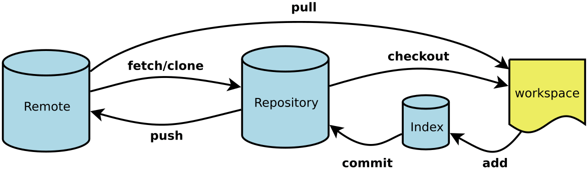

## 实验内容与步骤

### GitHub注册

登录[https://github.com/](https://github.com/)网站，选择注册

**填写注册信息，创建账号**

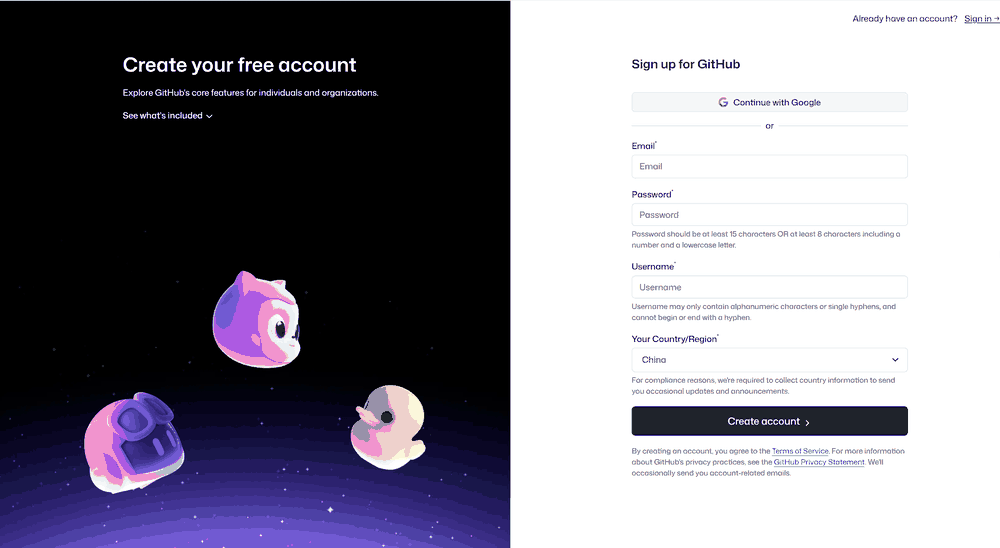

### 安装Git

登录[https://git-scm.com/](https://git-scm.com/)下载对应系统安装包。在Windows上使用Git，可以从Git官网直接下载安装程序，（网速慢的同学请移步国内镜像），然后按默认选项安装即可。

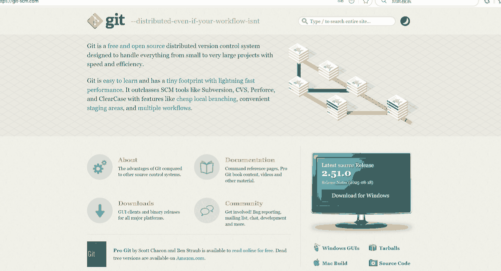

安装完成后，在开始菜单里找到"Git"->"Git Bash"，蹦出一个类似命令行窗口的东西，就说明Git安装成功！

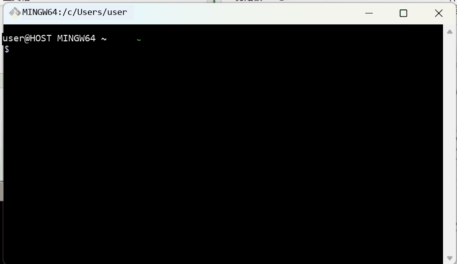

安装完成后，还需要最后一步设置，在命令行输入：

$ git config --global user.name "Your Name"

$ git config --global user.email <email@example.com>

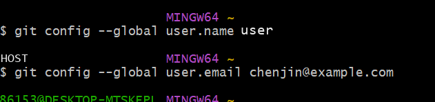

### 创建版本库

如下我是D盘 --> yun下 目录下新建一个testgit版本库。注意：yun目录已存在，可自行新建。

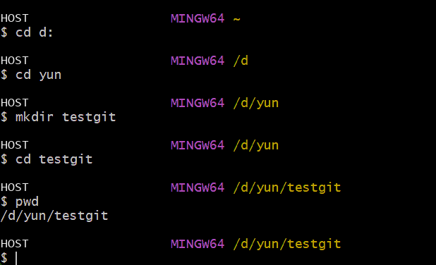

pwd 命令是用于显示当前的目录。

1.通过命令 git init 把这个目录变成git可以管理的仓库，如下：

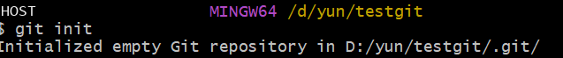

这时候你当前testgit目录下会多了一个.git的目录，这个目录是Git来跟踪管理版本的，没事千万不要手动乱改这个目录里面的文件，否则，会把git仓库给破坏了。如下：

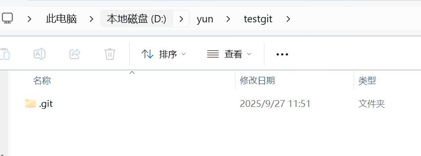

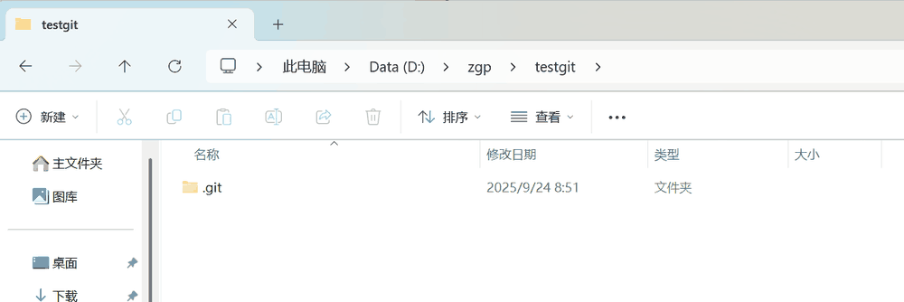

### 把文件添加到版本库中

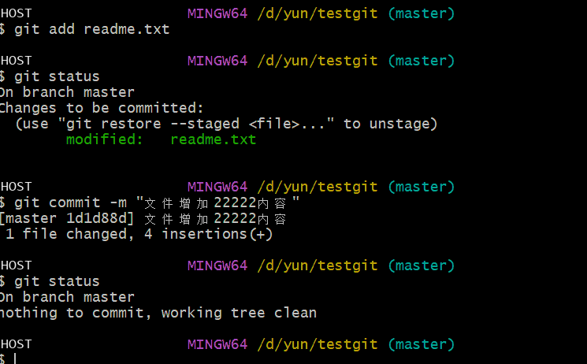

总结：Git提交文件到版本库有两步：

1.  是使用 git add 把文件添加进去，实际上就是把文件添加到暂存区。

2.  使用git commit提交更改，实际上就是把暂存区的所有内容提交到当前分支上。

### 撤销修改

比如我现在在readme.txt文件里面增加一行 内容为555555555555，我们先通过命令查看如下：

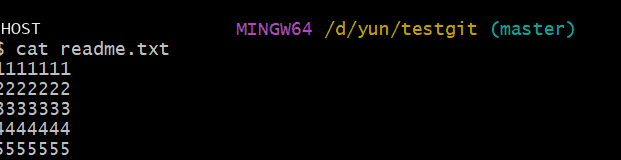

在我未提交之前，我发现添加5555555555555内容有误，所以我得马上恢复以前的版本，现在我可以有如下几种方法可以做修改：

第一：如果我知道要删掉那些内容的话，直接手动更改去掉那些需要的文件，然后add添加到暂存区，最后commit掉。

第二：我可以按以前的方法直接恢复到上一个版本。使用 git reset --hard HEAD\^

但是现在我不想使用上面的2种方法，我想直接想使用撤销命令该如何操作呢？首先在做撤销之前，我们可以先用 git status 查看下当前的状态。如下所示：

可以发现，Git会告诉你，git checkout -- file 可以丢弃工作区的修改，如下命令

git checkout -- readme.txt,如下所示：

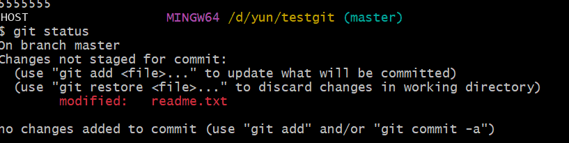

命令 git checkout --readme.txt 意思就是，把readme.txt文件在工作区做的修改全部撤销，这里有2种情况，如下：

1.  readme.txt自动修改后，还没有放到暂存区，使用 撤销修改就回到和版本库一模一样的状态。

2.  另外一种是readme.txt已经放入暂存区了，接着又作了修改，撤销修改就回到添加暂存区后的状态。

对于第二种情况，我想我们继续做demo来看下，假如现在我对readme.txt添加一行 内容为6666666666666，我git add 增加到暂存区后，接着添加内容7777777，我想通过撤销命令让其回到暂存区后的状态。如下所示：

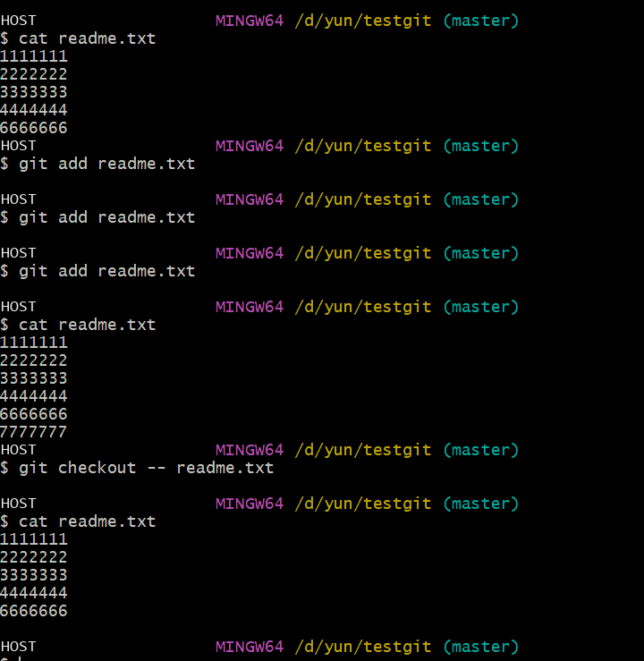

注意：命令git checkout -- readme.txt 中的 -- 很重要，如果没有 -- 的话，那么命令变成创建分支了。

### 删除文件

假如我现在版本库testgit目录添加一个文件b.txt,然后提交。如下：

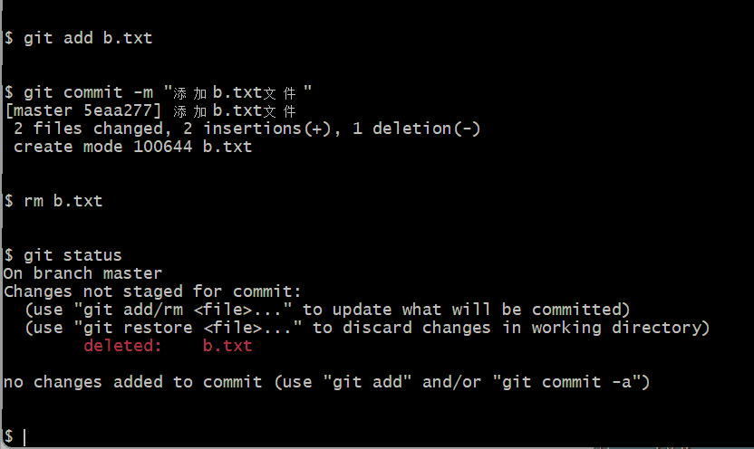

如上：一般情况下，可以直接在文件目录中把文件删了或者使用如上rm命令：rm b.txt ，如果我想彻底从版本库中删掉了此文件的话，可以再执行commit命令 提交掉，现在目录是这样的，

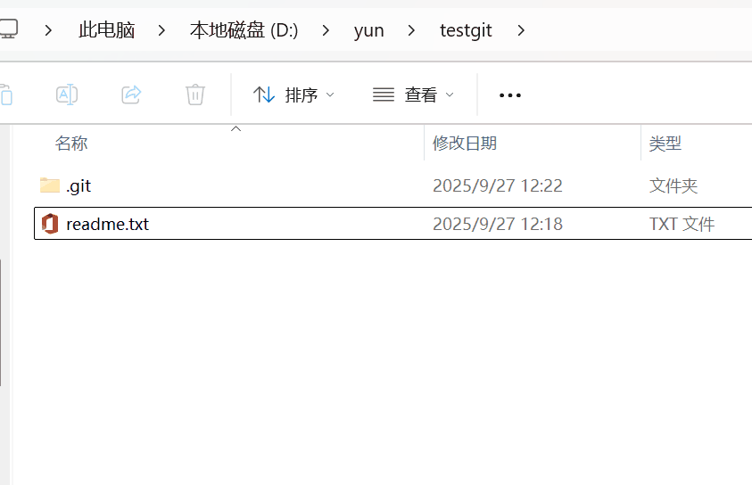

只要没有commit之前，如果我想在版本库中恢复此文件如何操作呢？

可以使用如下命令 git checkout -- b.txt，

再来看看我们testgit目录，添加1个文件了。如下所示：

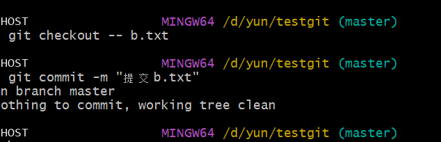

### 版本回退

如上，我们已经学会了修改文件，现在我继续对test1.txt文件进行修改，再增加一行内容为7777.继续执行命令如下：

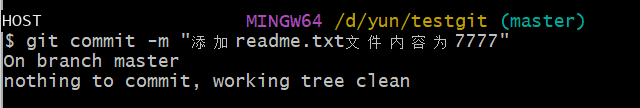

现在我已经对test1.txt文件做了三次修改了，那么我现在想查看下历史记录，如何查呢？我们现在可以使用命令 git log 演示如下所示：

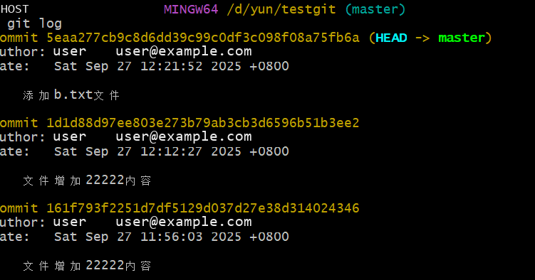

git log命令显示从最近到最远的显示日志，我们可以看到最近三次提交，最近的一次是,增加内容为7777.上一次是添加b.txt文件，第一次默认是 111111.如果嫌上面显示的信息太多的话，我们可以使用命令 git log --pretty=oneline 演示如下：

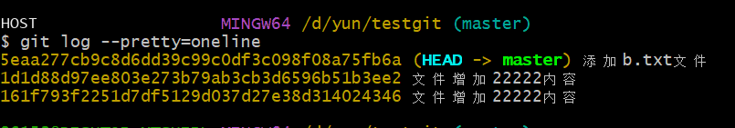

现在我想使用版本回退操作，我想把当前的版本回退到上一个版本，要使用什么命令呢？可以使用如下2种命令，第一种是：git reset --hard HEAD\^ 那么如果要回退到上上个版本只需把HEAD\^ 改成 HEAD\^\^ 以此类推。那如果要回退到前100个版本的话，使用上面的方法肯定不方便，我们可以使用下面的简便命令操作：git reset --hard HEAD~100 即可。未回退之前的readme.txt内容如下：

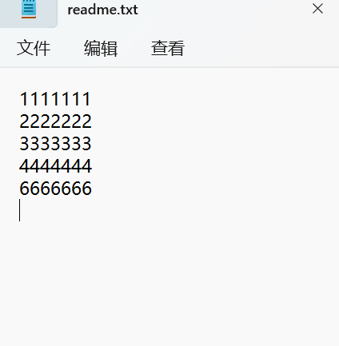

如果想回退到上一个版本的命令如下操作：

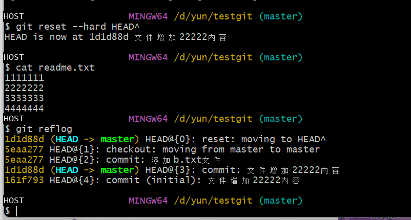

再来查看下 readme.txt内容如下：通过命令cat readme.txt查看。

版本回退也可以通过哈希值进行定位，查看日志命令git reflog:

通过前面的哈希值可以回退到指定版本

Git reset --hard 7d07fc2

**注意：使用指针（HEAD）与使用索引(哈希值）的区别为，指针只能往后退，索引可以前后移动，因此建议日常使用索引值回退。**

### 通过Git验证GitHub

**通过SSH建立连接**

选择SSH方式，用户需要在计算机中生存SSH keys，用来从GitHub密码缓存在Git。

在了解之前，先注册github账号，由于你的本地Git仓库和github仓库之间的传输是通过SSH加密的，所以需要一点设置：

1.  创建SSH Key。在用户主目录下，看看有没有.ssh目录，如果有，再看看这个目录下有没有id_rsa和id_rsa.pub这两个文件，如果有的话，直接跳过此如下命令，如果没有的话，打开命令行，输入如下命令：

ssh-keygen -t rsa --C "youremail@example.com", 运行过程中输入部分可以默认，直接按换行

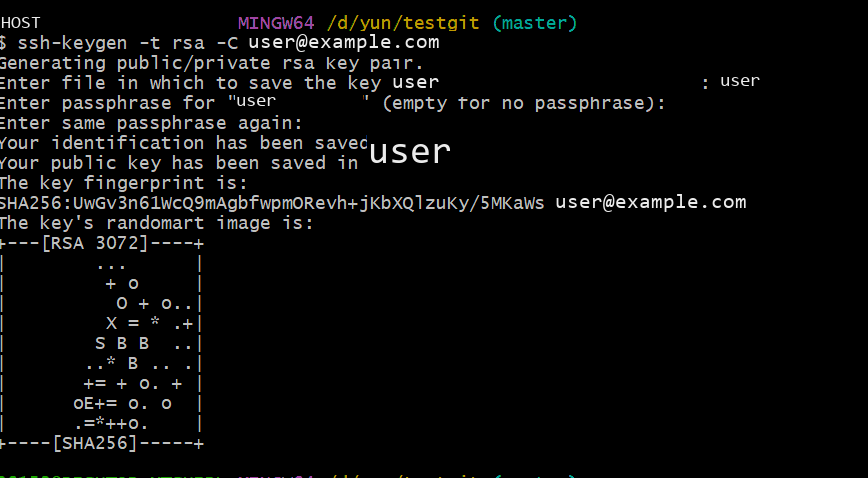

登录github,打开" settings"中的SSH Keys页面，然后点击"Add SSH Key",填上任意title，在Key文本框里黏贴id_rsa.pub文件的内容。

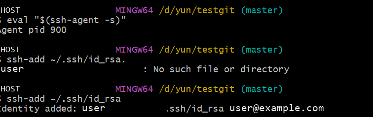

2.  登录github,打开" settings"中的SSH Keys页面，然后点击"Add SSH Key",填上任意title，在Key文本框里黏贴id_rsa.pub文件的内容。

id_rsa是私钥，不能泄露出去，id_rsa.pub是公钥，可以放心地告诉任何人。

然后在git bash输入eval "$(ssh-agent -s)"启动SSH Agent，输入ssh-add ~/.ssh/id_rsa添加生成的密钥到 SSH Agent。添加成功后，

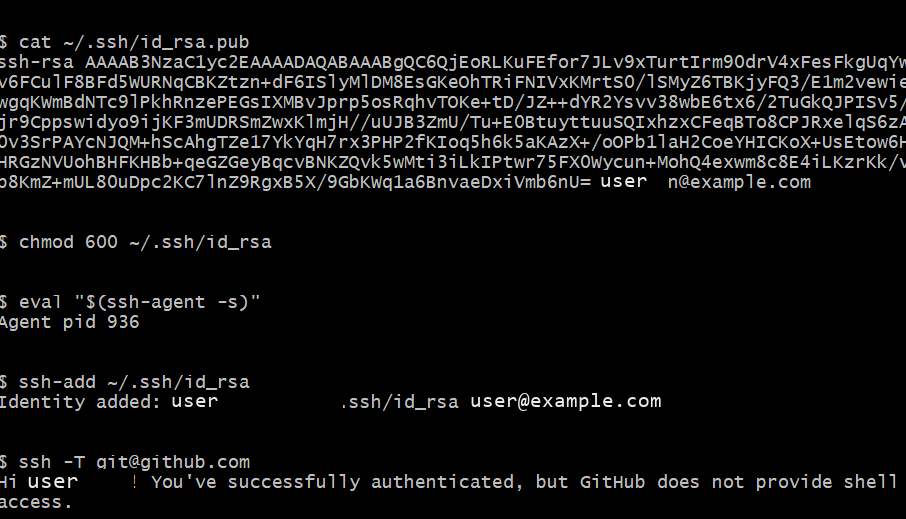

运行ssh -T git@github.com，可以看到类似的输出提示：

Hi <username>! You've successfully authenticated, but GitHub does not provide shell access.

点击 Add Key，你就应该可以看到已经添加的key。

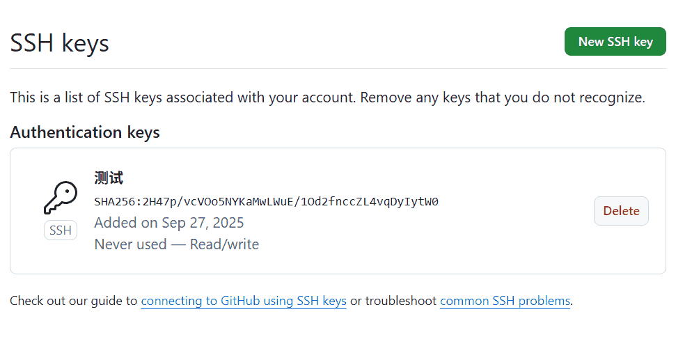

### 克隆远程仓库

先创建一个仓库

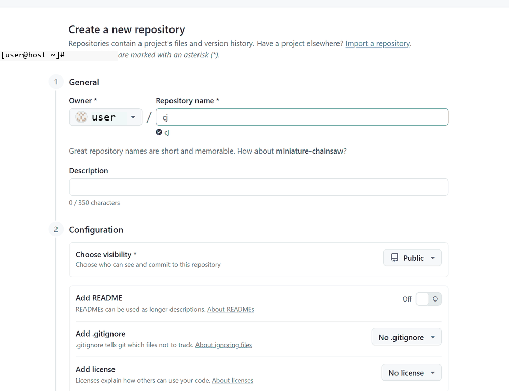

再进行克隆

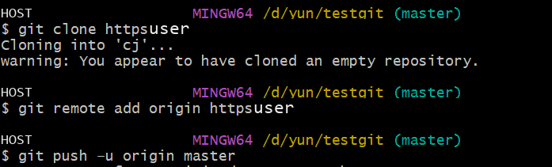

### 同步远程仓库

在项目目录下：

git remote add origin [https://github.com/cj3861709/cj.git](https://github.com/leopeng369/zgp.git)

git push --u origin master

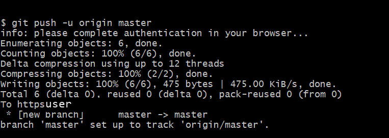

git push origin master

注意，如果无法同步，出现类似

fatal: unable to access 'https://github.com/example/web1.0.git/': schannel: server closed abruptly (missing close_notify)

的错误提示，可以运行git remote -v命令检查远程仓库，确保你项目的 Git 远程仓库地址使用的是 SSH 格式，输出应该类似如下：

origin git@github.com:<username>/<repository>.git (fetch)

origin git@github.com:<username>/<repository>.git (push)

如果输出的是其他格式，可以运行以下命令切换到 SSH：

[git remote set-url origin [git@github.com:<username>/<repository>.git](mailto:git@github.com:%3cusername%3e/%3crepository%3e.git)]

## 实验结果与分析

深刻体会出git的作用，在git bash中进行修改文件，返回版本。

## 结论与体会

深刻体会出git的作用，在git bash中进行修改文件，返回版本，在工作区创建，发到暂存区，在发送到仓库区；如何通过github中克隆远程仓库，在同步远程仓库，利用git进行撤销修改，删除文件
