# 实验二 · packstack安装OpenStack

## 实验目的

1.  掌握openstack的基础架构

2.  掌握采用packstack安装openstack的操作

3.  熟悉openstack的常用操作

## 实验原理

OpenStack是一个开源的云计算管理平台项目，由几个主要的组件组合起来完成具体工作。OpenStack支持几乎所有类型的云环境，项目目标是提供实施简单、可大规模扩展、丰富、标准统一的云计算管理平台。OpenStack通过各种互补的服务提供了基础设施即服务(IaaS)的解决方案，每个服务提供API以进行集成。

OpenStack组件介绍:

| 项目 | 代码名称 | 描述 |
| --- | --- | --- |
| 计算（Compute） | Nova | 管理虚拟机资源，包括CPU、内存、磁盘和网络接口 |
| 网络（Networking） | Neutron | 提供虚拟机网络接口资源，包括IP寻址、路由和软件定义网络（SDN） |
| 对象存储 （Object Storage） | Swift | 提供可通过RESTful API访问的对象存储 |
| 块存储 / （Block Storage） | Cinder | 为虚拟机提供块（传统磁盘）存储 |
| 身份认证服务 / （Identity） | Keystone | 为OpenStack组件提供基于角色的访问控制（RBAC），提供授权服务 |
| 镜像服务 / （Image Service） | Glance | 管理虚拟机磁盘镜像，为虚拟机和快照（备份）服务提供镜像 |
| 仪表盘 / （Dashboard） | Horizon | 为OpenStack提供基于Web的图形界面 |
| 计量服务 / （Telemetry） | Ceilometer | 集中为OpenStack各个组件收集计量和监控数据 |
| 编排服务 / （Orchestration） | Heat | 为OpenStack环境提供基于模板的云应用编排服务 |

## 实验仪器设备或材料

1.  个人计算机一台

2.  vmware worksation

3.  CentOS7

4.  Shell连接工具(FinalShell或者其他)

## 实验内容与步骤

### 环境规划

| 操作系统版本 | 硬件配置 | IP地址规划 | 主机名 | 虚拟机软件 | OpenStack版本 |
|:-----------|:-----------|:-----------|:---------|:-------------|:--------------|
| centos7.9 | 4vCPUS/8G 30G硬盘 | 192.168.10.1 | openstack | VMware WorkStation16 | Stein |

注：IP根据自己实际的实验环境修改，下同。

### 准备资料

OpenStack官方文档：https://docs.openstack.org/install-guide/

使用Packstack一键部署OpenStack的方式，隐藏了技术细节，如果使用中出来任何问题，我们都无法解决，所以体验完OpenStack的日常界面操作后，后期还是要仔细查看官方文档，然后一步步手工安装OpenStack各组件。

阿里云yum源设置官方文档：https://developer.aliyun.com/mirror/centos?spm=a2c6h.13651102.0.0.3e221b11Jpkdzb

### 部署过程

安装虚拟机

注意安装前要启用CPU的虚拟化设置

(以下步骤非常重要决定了部署OpenStack是否成功)

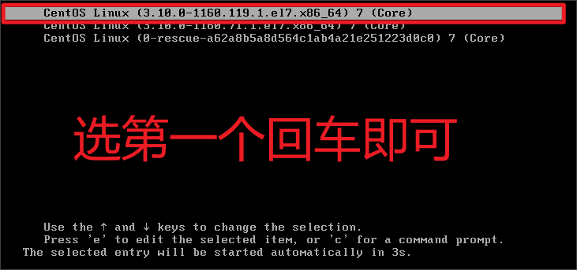

**修改centos系统的主机名**（切到root用户）

```bash
hostnamectl set-hostname yourhost
```

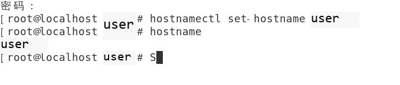

**设置centos系统为静态IP地址**

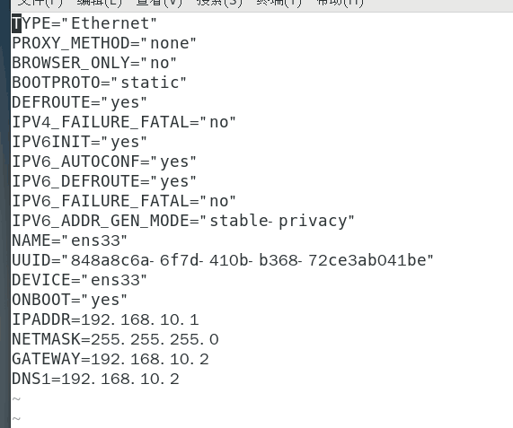

systemctl restart network

#测试网络是否通外网

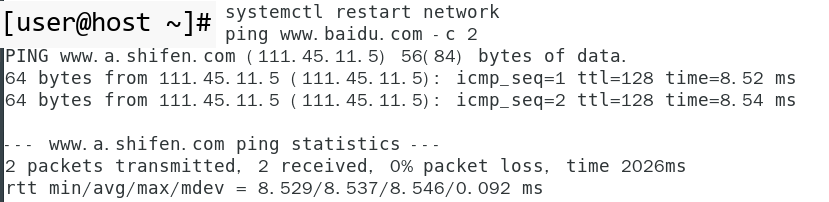

ping www.baidu.com -c 2

**关闭防火墙**

```bash
systemctl stop firewalld
systemctl disable firewalld
```

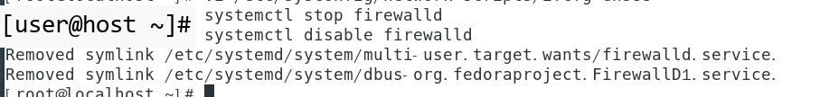

**关闭SeLinux**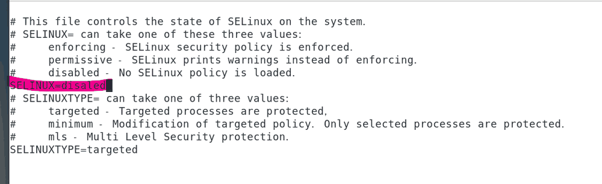

```bash
vi /etc/selinux/config
修改SELINUX=enforcing为SELINUX=disabled
运行setenforce 0使配置马上生效
```

**关闭NetworkManager服务**

```bash
systemctl stop NetworkManager
systemctl disable NetworkManager
```

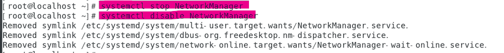

**修改官方yum源为阿里云yum源**

```bash
cd /etc/yum.repos.d/ //切换到/etc/yum.repos.d/文件夹
rm -rf * //删除/etc/yum.repos.d/下面的所有官方源文件
```


```bash
curl -o /etc/yum.repos.d/CentOS-Base.repo https://mirrors.aliyun.com/repo/Centos-7.repo
```

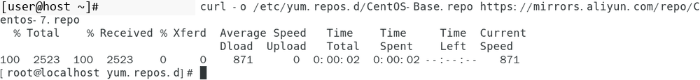

```bash
yum clean all
yum makecache #重建本地yum索引缓存
```

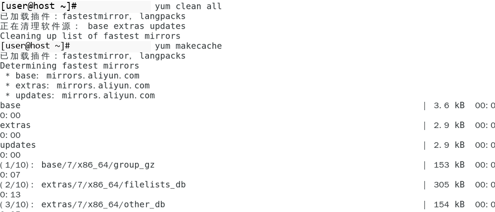

**系统升级**

```bash
yum -y update //对系统进行升级
```

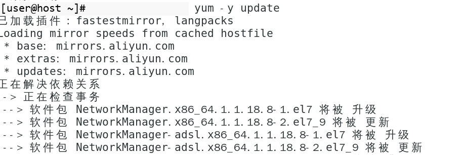

**安装OpenStack Stein的yum库**

```bash
yum -y install centos-release-openstack-stein
```

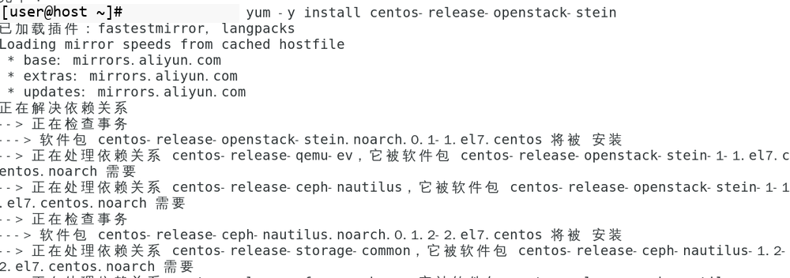

**修改CentOS-OpenStack-stein.repo配置文件**

```bash
cd /etc/yum.repos.d/
```


```bash
#修改配置文件
vi CentOS-OpenStack-stein.repo
原本的：
```

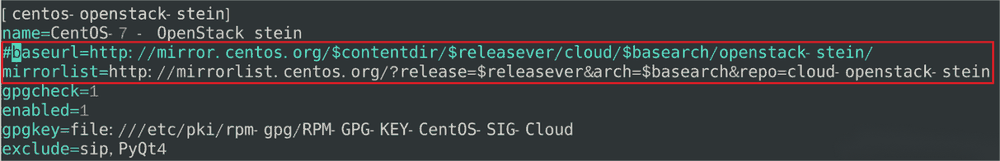

```bash
改为：
```

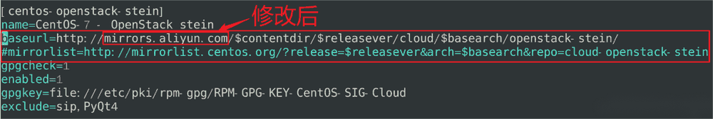

```bash
vi CentOS-Ceph-Nautilus.repo
原本的：
```

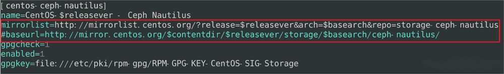

```bash
改为：
```

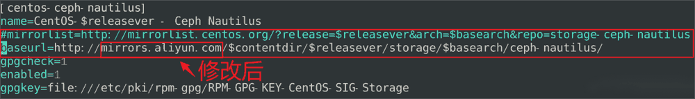

```bash
vi CentOS-QEMU-EV.repo
原本的：
```

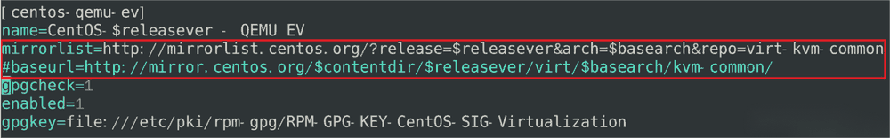

```bash
改为：
```

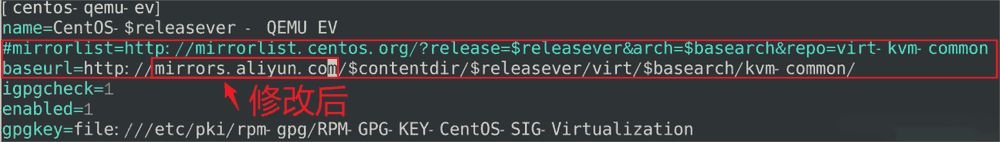

```bash
vi CentOS-NFS-Ganesha-28.repo
原本的：
```

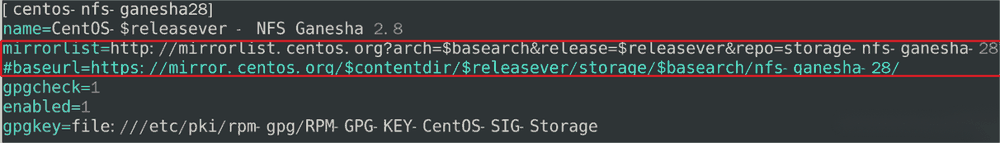

```bash
改为：
```

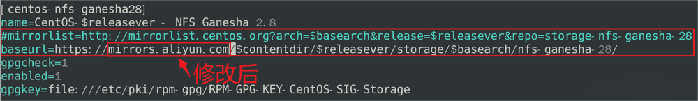

```bash
#清除本地yum索引缓存，然后再重建索引缓存
yum clean all && yum makecache
```

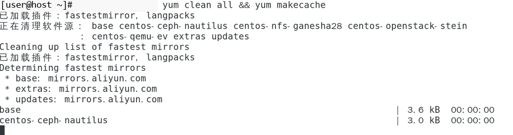

**关机并修改虚拟机配置**

```bash
init 0
```


**安装packstack工具**

```bash
yum -y install openstack-packstack
```

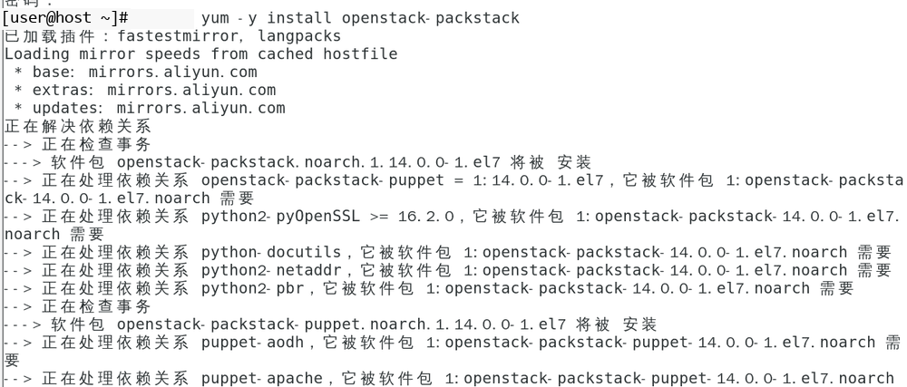

**安装OpenStack allinone**

```bash
packstack --allinone
```

自动化安装时间很长，静静等待，直到出现如下信息，表示成功安装。

| 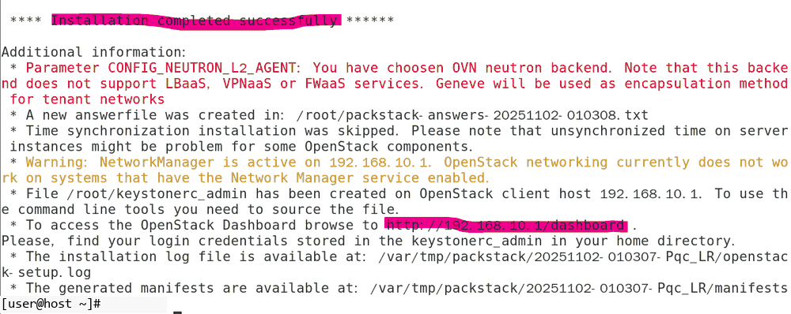 |
|:------------------------------------------------------------------|

**查看Dashboard web页面的登录账号及密码**

```bash
cd /root
cat keystonerc_admin
```

**Dashboard web登录界面**

登录方式：[http://192.168.10.1](http://192.168.10.1)

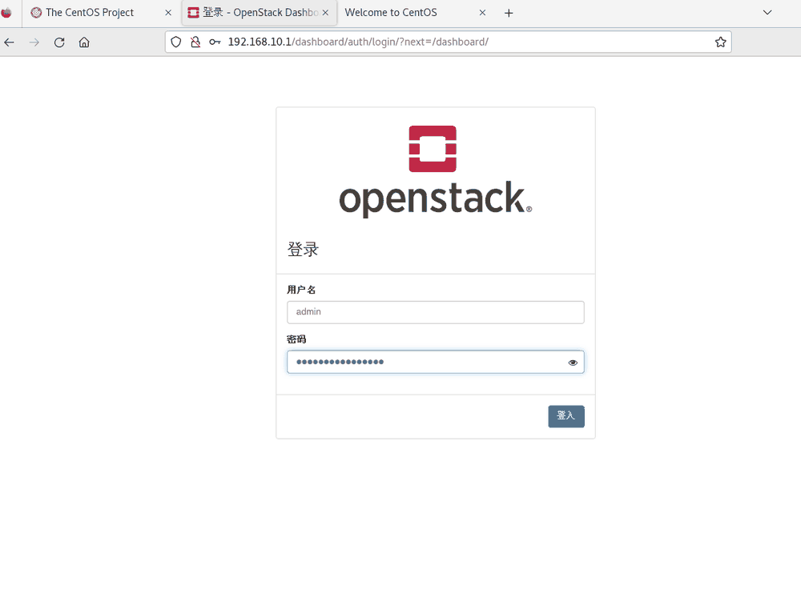

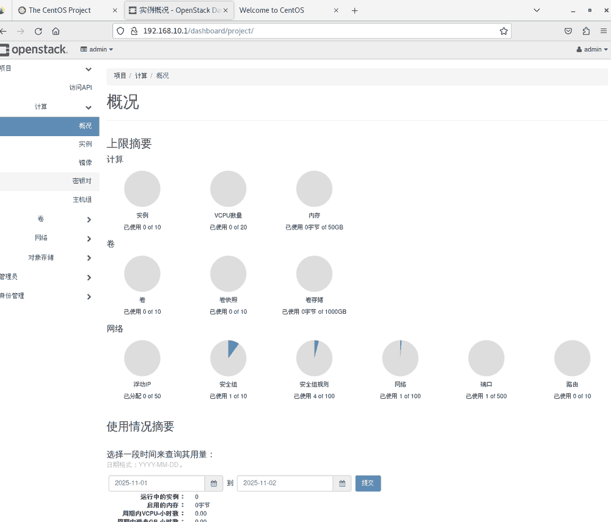

**修改Dashboard登录密码**

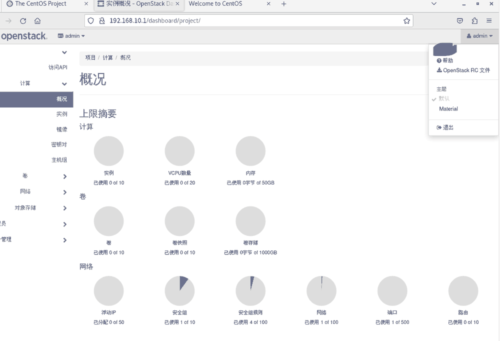

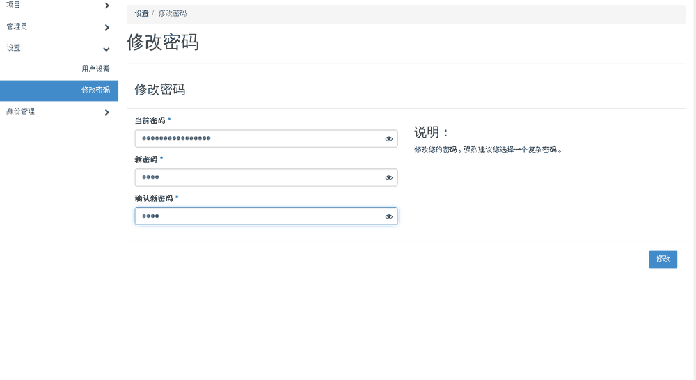

**使用新密码重新登录**

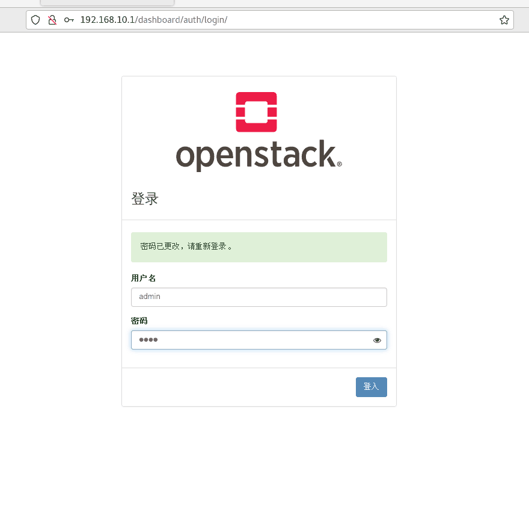

为以后的实验过程，同时需要修改keystonerc_admin文件中的OS_PASSWORD变量，换成新密码，如下：

```bash
vim keystonerc_admin
export OS_PASSWORD='admin' #填入修改后的新密码
```

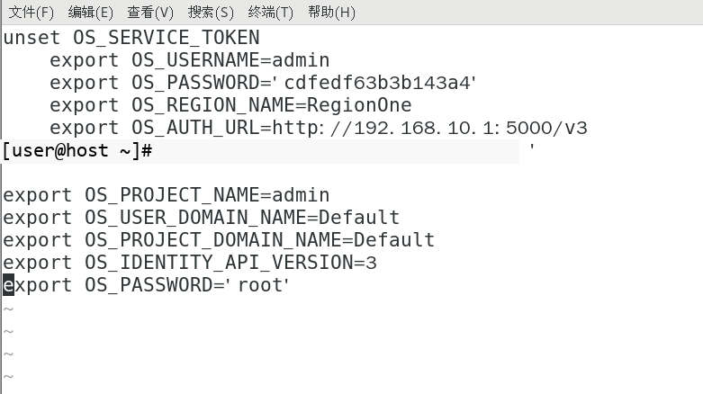

附：安装过程中的错误及解决办法

错误1：ERROR : Failed to run remote script, stdout:

stderr: Warning: Permanently added '172.17.2.60' (ECDSA) to the list of known hosts.

解决办法：

```bash
ssh-kengen
ssh-copy-id root@172.17.2.60
```

错误2：facter: error while loading shared libraries: leatherman_curl.so.1.3.0: cannot open shared object file: No such file or directory

原因：启用了epel库导致的

解决办法：

```bash
#1.禁用epel
yum-config-manager --disable epel
#2.清理yum索引缓存
yum clean all
#3.重建yum索引缓存
yum makecache
#4.降级leatherman
yum downgrade leatherman
```

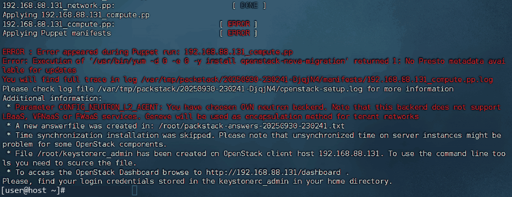

## 实验结果与分析

本次实验基于 CentOS 7.9 操作系统，通过 Packstack 工具成功完成 OpenStack Stein 版本的 All-in-One 模式部署。部署完成后，可通过http://192.168.10.1/dashboard访问 OpenStack DashboardWeb 界面，成功将登录密码更新为自定义密码，且更新后可正常重新登录，验证了账号权限管理功能的有效性。

## 结论与体会

本次实验也让我体会到 "云计算平台的实用性与复杂性平衡"。OpenStack 作为开源项目，其优势在于可扩展性强、支持自定义配置，但也正因组件众多，部署与维护门槛较高。
