# 实验三 · dacker的安装与应用

## 实验目的

1.  虚拟机环境下采用脚本安装Docker

2.  掌握Docker镜像的基本操作

3.  掌握Docker容器的基本操作

4.  掌握Docker Volume的基本操作

## 实验原理

Docker是一个开源的应用容器引擎，基于Go语言 并遵从Apache2.0协议开源。Docker 可以让开发者打包他们的应用以及依赖包到一个轻量级、可移植的容器中，然后发布到任何流行的 Linux 机器上，也可以实现虚拟化。容器是完全使用沙箱机制，相互之间不会有任何接口,更重要的是容器性能开销极低。Docker从 17.03 版本之后分为 CE（Community Edition: 社区版） 和 EE（Enterprise Edition: 企业版），我们用社区版就可以了。Docker的应用场景：

- Web 应用的自动化打包和发布。

- 自动化测试和持续集成、发布。

- 在服务型环境中部署和调整数据库或其他的后台应用。

- 从头编译或者扩展现有的 OpenShift 或 Cloud Foundry 平台来搭建自己的 PaaS 环境。

## 实验仪器设备或材料

1.  个人计算机一台

2.  vmware worksation

3.  CentOS7

4.  Docker社区版

## 实验内容与步骤

### 环境规划

| **操作系统** | **硬件配置** | **IP地址规划** | **主机名** | **虚拟机软件** |
|:----------|:-------------------|:--------------|:---------|:-----------------|
| centos7.9 | 4vCPUS/8G 50G硬盘 | 192.168.128.128 | Docker | VMware WorkStation17 |

### 安装docker

在workstation中安装虚拟机centos7。

### 查看系统内核版本

| 1   | uname -r |
|:----|:---------|

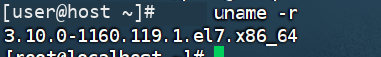

确保系统内核满足docker的运行要求。

查看系统版本信息

| 1   | cat /etc/os-release |
|:----|:--------------------|

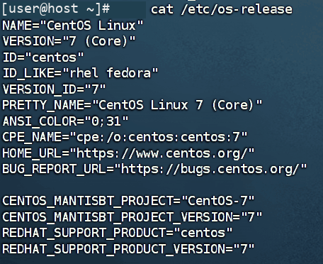

### 修改主机名（自己姓名全拼）

```bash
hostnamectl set-hostname yourhost
```

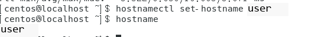

### 设置centos系统为静态IP地址,并确保系统能连接网络。

```bash
#注意修改自己的网卡配置文件
vi /etc/sysconfig/network-scripts/ifcfg-ens33
(IP根据自己实际实验环境设置)
#重启网络服务
systemctl restart network
#验证IP地址
ip addr
```

修改配置文件如下：

TYPE=Ethernet

PROXY_METHOD=none

BROWSER_ONLY=no

BOOTPROTO=static

DEFROUTE=yes

IPV4_FAILURE_FATAL=no

IPV6INIT=yes

IPV6_AUTOCONF=yes

IPV6_DEFROUTE=yes

IPV6_FAILURE_FATAL=no

IPV6_ADDR_GEN_MODE=stable-privacy

NAME=ens33

UUID=cf0a8d45-3fbe-4ab9-b76b-ccc488a9b14c

DEVICE=ens33

ONBOOT=yes

IPADDR=192.168.128.131

NETMASK=255.255.255.0

GATEWAY=192.168.128.2

DNS1=192.168.128.2

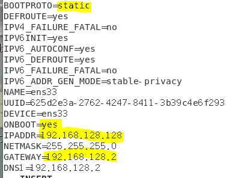

网络连通性可以ping www.baidu.com测试。

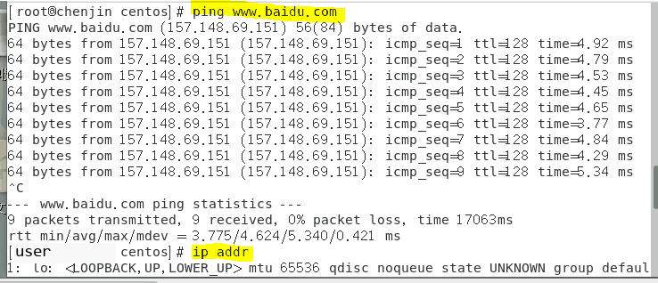

### 关闭防火墙

```bash
systemctl stop firewalld
systemctl disable firewalld
#查看防火墙状态
systemctl status firewalld
```

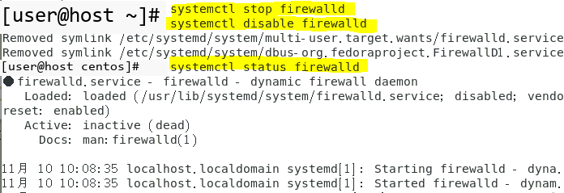

### 关闭selinux

```bash
vi /etc/selinux/config
#修改SELINUX=enforcing为SELINUX=disabled
setenforce 0
#使配置马上生效
```

使用FinalShell连接虚拟机，以下操作均在FinalShell中完成。(也可以在虚拟机完成）

### 关闭NetworkManager

```bash
systemctl stop NetworkManager
systemctl disable NetworkManager
#查看NetworkManager状态
systemctl status NetworkManager
```

网络连通性可以ping www.baidu.com测试。

### 修改官方yum源为阿里云yum源

```bash
cd /etc/yum.repos.d/ //切换到/etc/yum.repos.d/文件夹
rm -rf * //删除/etc/yum.repos.d/下面的所有官方源文件
curl -o /etc/yum.repos.d/CentOS-Base.repo https://mirrors.aliyun.com/repo/Centos-7.repo
#重建本地yum索引缓存
yum clean all
yum makecache
```

### 更新系统软件

| 1   | yum -y update |
|:----|:--------------|

### yum安装gcc相关环境（需要确保虚拟机可以上外网 ）

```bash
yum -y install gcc
yum -y install gcc-c++
```

### 卸载旧版docker(如果以前安装过旧版就先卸载，新装系统无需进行此操作）

```bash
yum remove docker \
docker-client \
docker-client-latest \
docker-common \
docker-latest \
docker-latest-logrotate \
docker-logrotate \
docker-engine
```

删除/var/lib/docker/目录

| 1   | rm -rf /var/lib/docker/ |
|:----|:------------------------|

### yum安装docker

```bash
## step 1: 安装必要的一些系统工具
sudo yum install -y yum-utils
## Step 2: 添加软件源信息
yum-config-manager --add-repo https://mirrors.aliyun.com/docker-ce/linux/centos/docker-ce.repo
## Step 3: 安装Docker
yum -y install docker-ce docker-ce-cli containerd.io docker-buildx-plugin docker-compose-plugin
## Step 4: 开启Docker服务
service docker start
```

### 查看docker是否安装成功

| 1   | docker version |
|:----|:---------------|

应该看到类似下图的相关信息

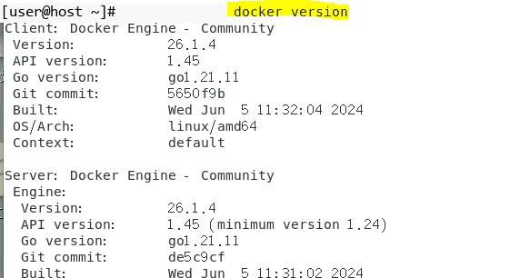

如果出现相关信息，则安装成功。

附：卸载docker步骤(此步了解即可，不用操作)

```bash
systemctl stop docker
yum -y remove docker-ce docker-ce-cli containerd.io docker-buildx-plugin docker-compose-plugin
rm -rf /var/lib/docker
```

### 设置国内镜像加速

由于docker官方的hub公共仓库在国外，国内经常访问不到，因此需要配置国内的访问镜像。

阿里云镜像加速器设置：

- 是什么 https://www.aliyun.com/

- 注册一个属于自己的阿里云账户(可复用淘宝账号)

- 获得加速器地址连接（每人都不一样）

- 粘贴脚本直接执行

- 重启服务器

```bash
## 创建目录
sudo mkdir -p /etc/docker
## 写入配置文件（换成自己的加速器地址）
vi /etc/docker/daemon.json
{
"registry-mirrors": [
"https://docker.1panel.live",
"https://docker.1ms.run",
"https://dytt.online",
"https://docker-0.unsee.tech",
"https://lispy.org",
"https://docker.xiaogenban1993.com",
"https://666860.xyz",
"https://hub.rat.dev",
"https://docker.m.daocloud.io",
"https://demo.52013120.xyz",
"https://proxy.vvvv.ee",
"https://registry.cyou",
"https://mirror.ccs.tencentyun.com",
"https://wt61z6ai.mirror.aliyuncs.com"
]
}
## 重启docker服务
systemctl daemon-reload
sudo systemctl restart docker
```

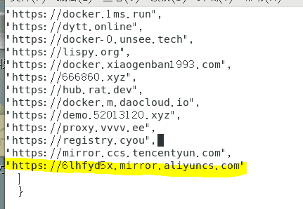

运行docker info命令可以查看配置是否已经生效：

| 1   | docker info |
|:----|:------------|

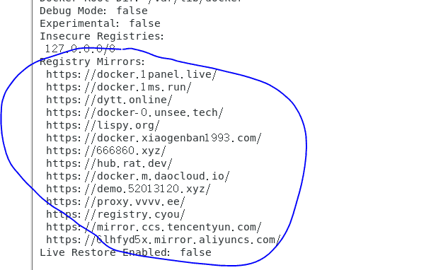

如果以上镜像都无法访问，请百度搜索可用的镜像或者在以下网址列表中尝试：

https://www.coderjia.cn/archives/dba3f94c-a021-468a-8ac6-e840f85867ea

### docker基础命令

```bash
systemctl start docker #启动docker
systemctl stop docker #关闭docker
systemctl restart docker #重启docker
systemctl enable docker #设置开机自启动
systemctl status docker #查看docker运行状态
docker version #查看docker版本号信息
docker info #查看概要信息
docker --help #docker命令提示
docker 具体命令 --help #查看docker具体命令帮助文档
```

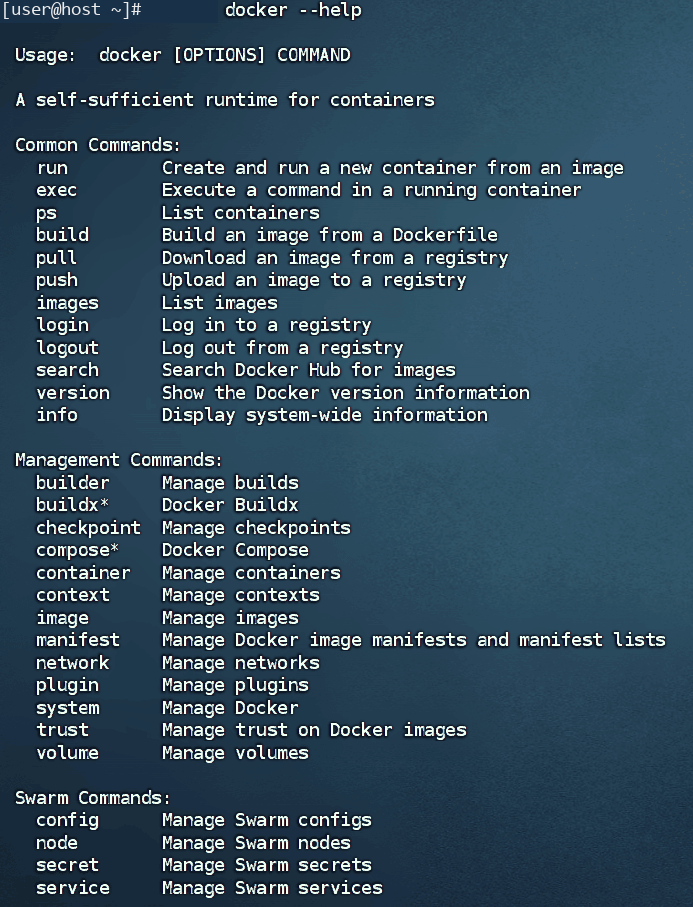

### docker镜像命令

镜像的名称组成：镜名称一般分两部分组成：repository:tag。在没有指定tag时，默认是latest，代表最新版本的镜像。如图：这里的mysql就是repository，5.7就是tag，合一起就是镜像名称，代表5.7版本的MySQL镜像。

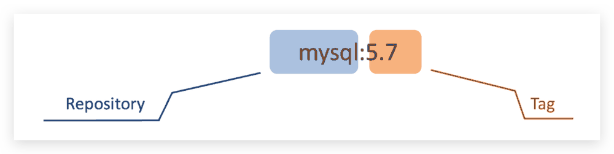

常见的镜像操作命令如图：

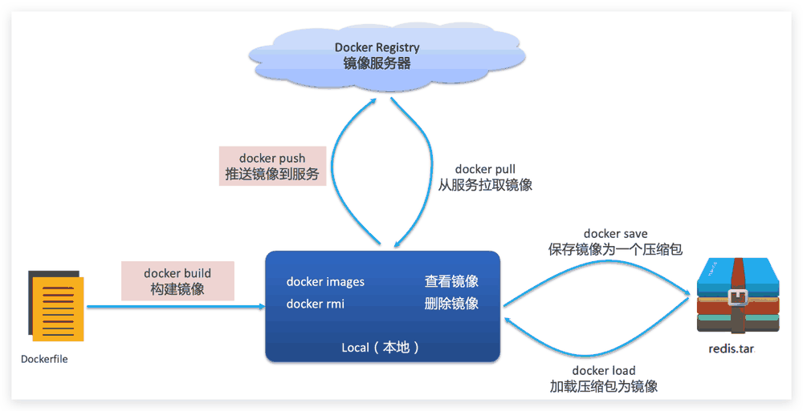

```bash
docker images #查看镜像 -a列出本地所有的镜像(含历史映像层) -q 只显示镜像ID
#从Docker Hub查找/搜索镜像（在Docker Hub上搜索镜像）
docker search [options] TERM
docker search -f STARS=9000 mysql #搜索stars收藏数不小于10以上的mysql镜像
#从服务器拉取镜像拉取镜像
docker pull 镜像名 #拉取最新版本的镜像
docker pull 镜像名:tag #拉取镜像，指定版本
docker system df #查看镜像/容器/数据卷所占的空间
#删除镜像。当前镜像没有被任何容器使用 才可以删除
docker rmi 镜像名/镜像ID #删除镜像
docker rmi -f 镜像名/镜像ID #强制删除
docker rmi -f 镜像名 镜像名 镜像名 #删除多个 其镜像ID或镜像用用空格隔开即可
docker rmi -f $(docker images -aq) #删除全部镜像，-a 意思为显示全部, -q 意思为只显示ID
docker image rm 镜像名称/镜像ID #强制删除镜像
#推送镜像到服务
docker push 镜像名
docker push 镜像名:tag
docker save -o 保存的目标文件名称 镜像名 #保存镜像为一个压缩包
docker load -i 文件名 #加载压缩包为镜像
#给镜像打标签【有时候根据业务需求 需要对一个镜像进行分类或版本迭代操作，此时就需要给镜像打上标签】
docker tag SOURCE_IMAGE[:TAG] TARGET_IMAGE[:TAG]
```

#### 案例1--拉取、查看镜像

打开网络共享仓库https://docker-0.unsee.tech/，搜索可用的镜像。

拉取hello-world镜像

| 1   | docker pull hello-world |
|:----|:------------------------|

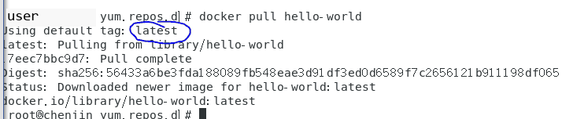

同一仓库源可以有多个 TAG版本代表这个仓库源的不同个版本，使用 REPOSITORY:TAG 来定义不同的镜像。如果不指定一个镜像的版本标签，例如只使用hello-world，docker将默认使用hello-world:latest镜像。

从https://docker-0.unsee.tech/搜索nginx（高性能的HTTP和反向代理web服务器）的可用版本，并拉取其中的3个版本。

```bash
docker pull nginx:1.27 #拉取nginx1.27版本
docker pull nginx:1.26 #拉取nginx1.26版本
docker pull nginx:latest #拉取nginx最新版本
```

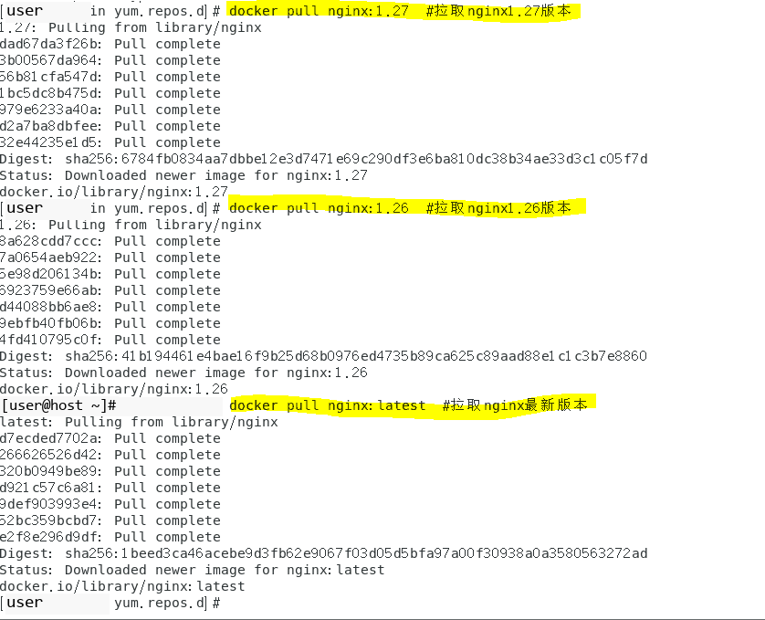

查看主机上现有的镜像：

| 1   | docker images |
|:----|:--------------|

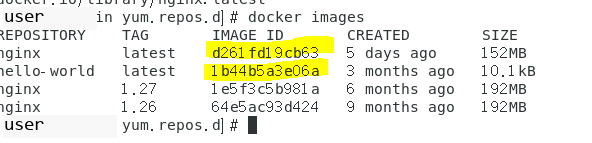

有两个ID是一样的，是因为最新版本就是1.27版本。

```bash
## 解释
REPOSITORY 镜像的仓库源
TAG 镜像的标签版本号
IMAGE ID 镜像的ID
CREATED 镜像创建时间
SIZE 镜像大小
```

#### 案例2--保存、导入镜像

需求：利用docker save将nginx：1.26镜像导出磁盘，然后再通过load加载回来。

*在实际应用中，经常会将开发完成的环境整个导出，然后再在测试环境和正式生产环境加载部署。*

| 1   | docker save -o /root/nginx-latest.tar nginx:latest |
|:----|:---------------------------------------------------|

运行成功后，在/root目录下应该有nginx-1.26.tar文件。

删除nginx：1.26镜像：

| 1   | docker rmi nginx:latest |
|:----|:------------------------|

注意：nginx:1.26也可以用镜像ID。

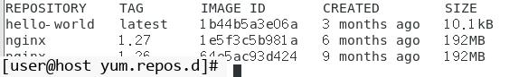

查看镜像可见nginx1.26已经被删除。

然后运行镜像导入命令：

| 1   | docker load -i /root/nginx-latest.tar |
|:----|:--------------------------------------|

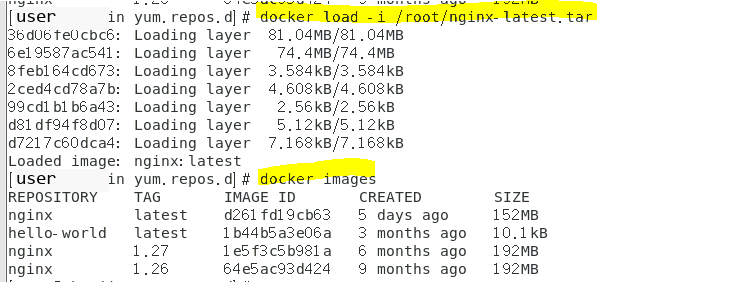

镜像被重新安装了。

### docker容器命令

docker容器的启动需要镜像的支持，有镜像才能创建容器，这是根本前提。容器操作的命令如图：

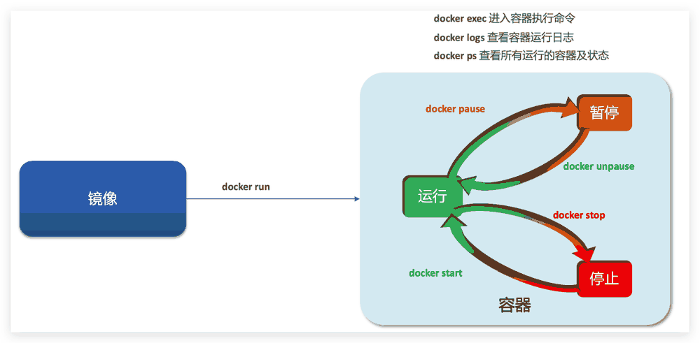

容器保护三个状态：

运行：进程正常运行

暂停：进程暂停，CPU不再运行，并不释放内存

停止：进程终止，回收进程占用的内存、CPU等资源

其中：

docker run：创建并运行一个容器，处于运行状态

docker pause name：让一个运行的容器暂停

docker unpause name：让一个容器从暂停状态恢复运行

docker stop name：停止一个运行的容器（杀死进程、回收内存，仅剩文件系统）

docker start name：让一个停止的容器再次运行

docker restart name：重启容器

docker rm：删除一个容器（进程、内存回收、文件系统彻底干掉）

```bash
新建+启动容器
docker run
#这里要注意，如果容器未向外提供任何服务，将会自动停止
#容器怎么来？ docker run 创建并运行一个容器，处于运行状态。
#--name 给要运行的容器起的名字； -p 将宿主机端口与容器端口映射，冒号左侧是宿主机端口，右侧是容器端口； -d 表示可后台运行容器 （守护式运行）；添加参数--restart=always，表示该容器随docker服务启动而自动启动。具体样例见下
docker run --name containerName --restart=always -p 80:80 -d nginx
列出当前所有正在运行的容器
docker ps #显示正在运行的容器
docker ps -a #-a,--all 显示全部容器，包括已停止的（默认只显示运行中的容器）
退出容器
Exit #run进去容器，exit退出，容器停止
ctrl+p+q #run进去容器，ctrl+p+q退出，容器不停止
启动已停止运行的容器
docker start name #让一个停止的容器再次运行
docker pause 容器名/容器ID #让一个运行的容器暂停
docker unpause name #让一个容器从暂停状态恢复运行
docker stop name #停止一个运行的容器（杀死进程、回收内存，仅剩文件系统）
docker kill 容器名 #强制停止容器
#docker stop与docker kill的区别：都可以终止运行中的docker容器。类似于linux中的kill和kill -9这两个命令，docker stop与kill相似，docker kill与kill -9类似
docker restart name #重启容器
docker rename 容器名 新容器名 #更换容器名
#删除容器
docker rm 容器名/容器ID #删除容器
docker rm -f CONTAINER #强制删除
docker rm -f 容器名 容器名 容器名 #删除多个容器 空格隔开要删除的容器名或容器ID
docker rm -f $(docker ps -aq) #删除全部容器
启动守护式容器（后台服务器）
在大部分的场景下，我们希望docker的服务是在后台运行的，我们可以过-d指定容器的后台运行模式。
Docker run -d 容器名 redis前后台启动演示case
docker logs 容器名 #查看容器运行日志
docker logs -f 容器名 #持续跟踪日志
docker logs -f --tail=20 容器名 #查看末尾多少行
docker top 容器ID #查看容器内运行的进程
docker inspect 容器ID #查看容器内部细节
#进入容器执行命令，两种方式 docker exec 和 docker attach，推荐docker exec
attach直接进入容器启动命令的终端，不会启动新的进程用exit退出，会导致容器的停止。
exec是在容器中打开新的终端，并且可以启动新的进程用exit退出，不会导致容器的停止。
#方式一 docker exec。
docker exec -it 容器名/容器ID bash
#方式二 docker attach，推荐使用docker exec
docker attach 容器名/容器ID
从容器内拷贝文件到主机上
```

**案例--创建并运行一个容器**

```bash
docker run --name gcc-web -p 80:80 -d nginx:1.27
docker ps
```

以上命令用nginx1.27版本的镜像创建一个名称为gcc-web的后台运行的容器，宿主机TCP80端口映射到容器80端口。运行docker ps可以查看当前运行中的容器。

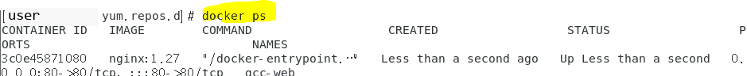

运行docker inspect 会以 [json 格式](https://so.csdn.net/so/search?q=json%20%E6%A0%BC%E5%BC%8F&spm=1001.2101.3001.7020)得到 docker 镜像/容器的元数据。

| 1   | docker inspect gcc-web |
|:----|:-----------------------|

运行docker log 可以输出容器的运行日志。

| 1   | docker logs -f --tail=20 gcc-web |
|:----|:----------------------------------|

容器正常运行后，在浏览器输入http://192.168.64.11（IP改成自己实验的实际IP），应该可以看到如下网页：

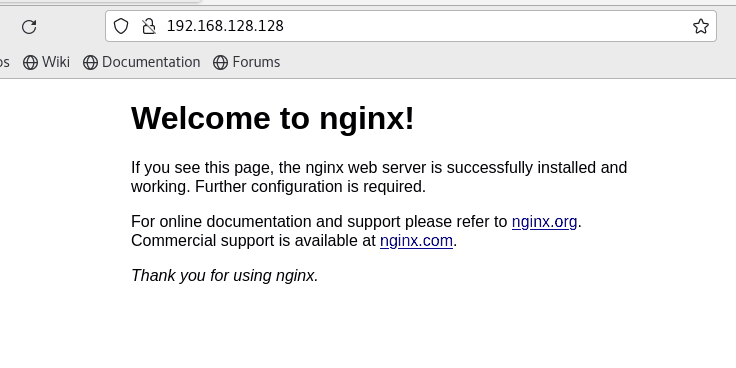

进入容器进行操作：

| 1   | docker exec -it gcc-web bash |
|:----|:-----------------------------|

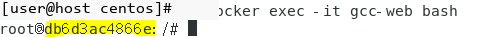

注意，成功进入后，现在shell界面操作的就是容器内的系统了。

运行ls命令可以看出，容器内是一个完整的linux系统目录结构。

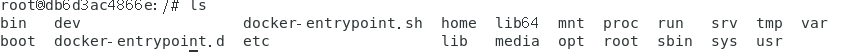

运行whereis nginx可以查找nginx软件安装的相关目录

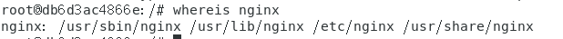

其中/etc/nginx目录是nginx配置文件目录。

打开/etc/nginx/nginx.conf查看主配置文件：

| 1   | cat /etc/nginx/nginx.conf |
|:----|:--------------------------|

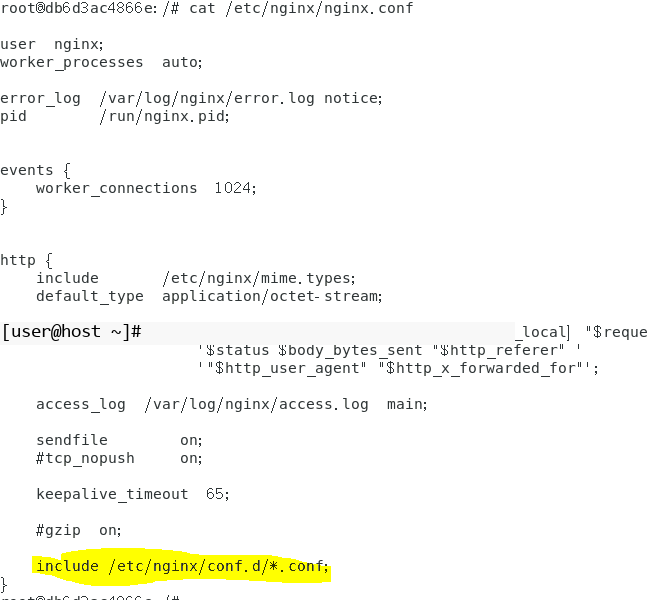

在主配置可以看到另外引用了其他文件，打开此目录：

```bash
cd /etc/nginx/conf.d/
ls
```

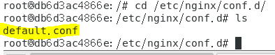

目录下有一个default.conf文件，这个是nginx的站点配置文件，打开此文件查看：

| 1   | cat default.conf |
|:----|:-----------------|

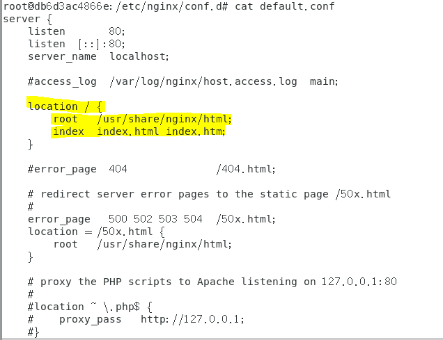

可以看到，网站根目录在/usr/share/nginx/html，切换到此目录，浏览目录文件：

```bash
cd /usr/share/nginx/html
ls
```

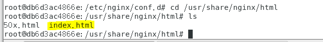

这个是站点的主页，可以打开编辑这个文件，但容器一般都精简安装，大部分没安装文件编辑软件，可以尝试在容器内安装一个vim软件。

查看/etc/os-release文件，看系统内核版本：

| 1   | cat /etc/os-release |
|:----|:--------------------|

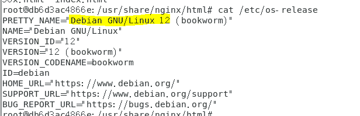

Debian系统需要apt-get命令进行升级和安装软件

```bash
apt-get -y update
apt-get -y install vim
```

安装vim后可以编辑/usr/share/nginx/html/index.html文件，修改主页内容。

| 1   | vi /usr/share/nginx/html/index.html |
|:----|:------------------------------------|

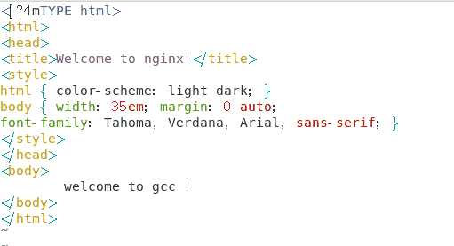

保存退出后再打开http://192.168.64.11看是否生效。

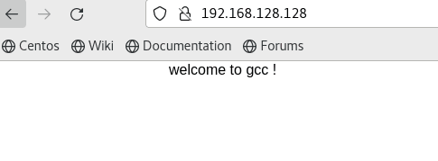

## 数据卷操作

**什么是容器数据卷？**

将应用和运行的环境打包形成容器运行，运行可以伴随着容器，但是我们对于数据的要求，是希望能够持久化的！

所以我们希望容器之间有可能可以共享数据，Docker容器产生的数据，如果不通过docker commit生成新的镜像，使得数据作为镜像的一部分保存下来，那么当容器删除后，数据自然也就没有了！这样是行不通的！

为了能保存数据在Docker中就可以使用卷！让数据挂载到我们本地！这样数据就不会因为容器删除而丢失了！

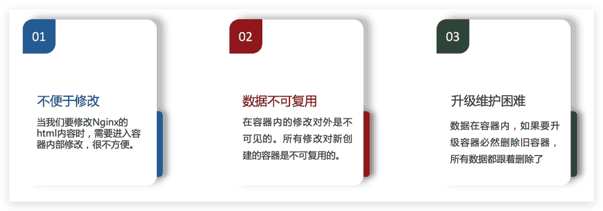

卷就是目录或者文件，存在一个或者多个容器中，由docker挂载到容器，但不属于联合文件系统，因此能够绕过 Union File System，提供一些用于持续存储或共享数据的特性：卷的设计目的就是数据的持久化，完全独立于容器的生存周期，因此Docker不会在容器删除时删除其挂载的数据卷。

特点：

1.  数据卷可在容器之间共享或重用数据

2.  卷中的更改可以直接生效

3.  数据卷中的更改不会包含在镜像的更新中

4.  数据卷的生命周期一直持续到没有容器使用它为止

所以：总结一句话： 就是容器的持久化，以及容器间的继承和数据共享！

**案例--挂载nginx网站目录到宿主主机**

**按ctrl+p+q键退出容器。**

*注：此方法退出容器，不会影响停止容器运行，如果用exit命令退出，可能会导致容器停止。*

为容器添加挂载，有2种方式：

1.  方式：如果第一次生成容器或者容器内无任何数据，可以删除容器，重新生成，或者生成一个新的容器（不同名称）。

```bash
mkdir /gccweb
docker stop gcc-web
docker run --name gcc-web2 -v /gccweb:/usr/share/nginx/html -p 80:80 -d nginx
```

2.  方式：如果容器内已经有较多的数据和个性化配置，可以进入cd /var/lib/docker/containers/<容器ID>,修改config.v2.json文件，在 MountPoints 字段中添加挂载路径。

```bash
"MountPoints": {
"/usr/share/nginx/html": {
"Source": "/gccweb",
"Destination": "/usr/share/nginx/html",
"RW": true,
"Name": "",
"Driver": "",
"Type": "bind",
"Propagation": "rprivate",
"Spec": {
"Type": "bind",
"Source": "/gccweb",
"Target": "/usr/share/nginx/html"
},
"SkipMountpointCreation": false
}
},
```

hostconfig.json‌：在 Binds 字段中添加 "宿主机路径:容器路径"

```bash
"Binds": [
"/gccweb:/usr/share/nginx/html"
],
```

重启容器

| 1   | docker restart <容器名> |
|:----|:--------------------------|

*注意：实验采用第一种方法即可。*

把"示例网页.zip"里的文件解压缩，全部上传到/gccweb文件夹，上传后其目录结构如下图所示：

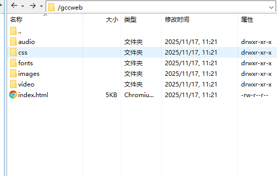

打开浏览器，访问http://192.168.128.128。（IP改为自己实际IP）


转换容器为镜像文件：

| 1   | docker commit gcc-web2 my-nginx:1.0 |
|:----|:------------------------------------|

运行docker images，应该可以看到刚刚创建的镜像：

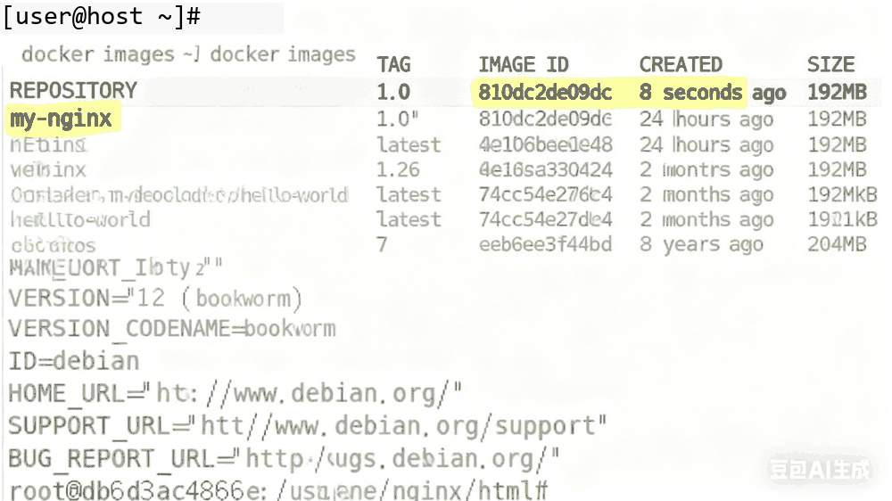

镜像打包成文件

| 1   | docker save -o /root/my-nginx_1.0.tar my-nginx:1.0 |
|:----|:---------------------------------------------------|

在root目录下应该可以看到my-nginx_1.0.tar，此文件可以在其他主机上进行部署。

## 实验结果与分析

本次实验成功在 CentOS7 虚拟机中安装 Docker 社区版，配置国内镜像加速后，实现了镜像拉取、保存、加载，容器创建、运行、进入、停止等基础操作，完成了 Nginx 容器与宿主主机目录的挂载，且将容器成功转换为自定义镜像并打包。实验过程中，网络连通性测试、防火墙与 SELinux 关闭、Yum 源替换等步骤为 Docker 安装提供了稳定环境，镜像加速有效解决了官方仓库访问缓慢问题，数据卷挂载实现了网站数据的持久化存储，各项操作均达到预期目标。

## 结论与体会

通过本次实验，我熟练掌握了 Docker 的核心操作流程，理解了镜像、容器、数据卷的关联逻辑。实践中发现，环境配置的规范性（如静态 IP 设置、依赖安装）是实验成功的关键，而国内镜像加速和数据卷挂载的应用，显著提升了 Docker 使用的效率与实用性。此次实验让我体会到 Docker 在应用打包与部署中的便捷性，为后续学习容器编排等进阶内容奠定了基础。
