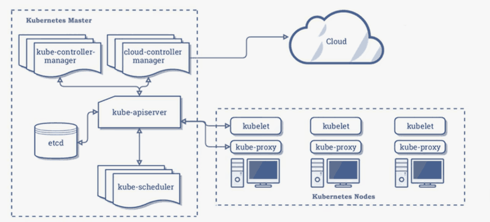
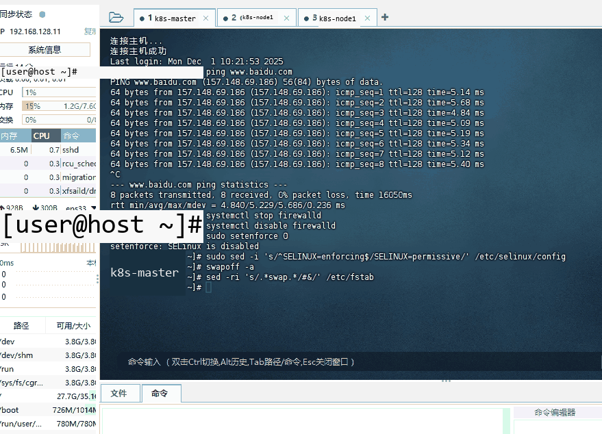
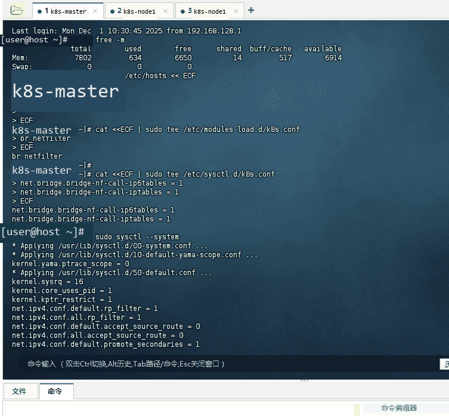
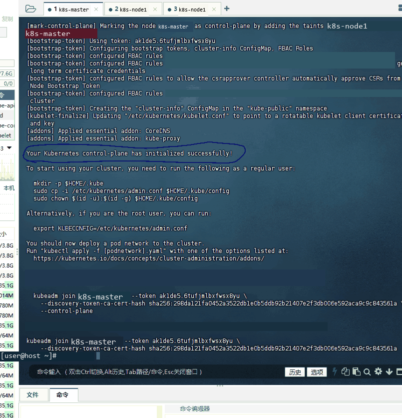
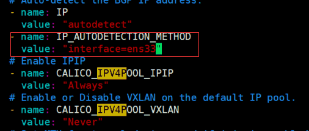
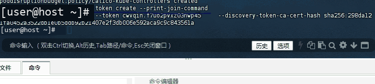
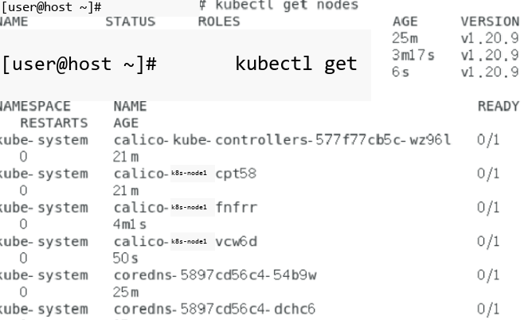

# 实验四 · Kubernetes集群部署

## 实验目的

1. 了解kubernetes核心架构

2. 掌握kubernetes集群部署

## 实验原理

Kubernetes，也被称为K8s，是一个用于自动化部署、扩展和管理容器化应用的开源系统。



## 实验仪器材料

1.  个人计算机一台

2.  vmware worksation

3.  CentOS7

4.  kubernetes

## 实验内容与步骤
### 准备机器

搭建K8S集群，准备三台2核4G的虚拟机(内存至少2G以上)，操作系统选择用centos 7以上版本（IP地址根据自己虚拟机更改，三台要不一样IP）

|   主机（IP）   | 说明（主机名） |
|:--------------:|:--------------:|
| 192.168.128.11 |   cj-master    |
| 192.168.128.12 |    cj-node1    |
| 192.168.128.13 |    cj-node2    |

分别修改三台虚拟机的主机名和IP

1.  给三台主机修改主机名

hostnamectl set-hostname xxx

第一台：cj-master

第二台：cj-node1

第三台：cj-node2

2.  给三台主机设置centos系统为静态IP地址,并确保系统能连接网络。

```bash
#注意修改自己的网卡配置文件
vi /etc/sysconfig/network-scripts/ifcfg-ens33
(IP根据自己实际实验环境设置)
TYPE=Ethernet
PROXY_METHOD=none
BROWSER_ONLY=no
BOOTPROTO=static
DEFROUTE=yes
IPV4_FAILURE_FATAL=no
IPV6INIT=yes
IPV6_AUTOCONF=yes
IPV6_DEFROUTE=yes
IPV6_FAILURE_FATAL=no
IPV6_ADDR_GEN_MODE=stable-privacy
NAME=ens33
UUID=cf0a8d45-3fbe-4ab9-b76b-ccc488a9b14c
DEVICE=ens33
ONBOOT=yes
IPADDR=192.168.128.11
NETMASK=255.255.255.0
GATEWAY=192.168.128.2
DNS1=192.168.128.2
#重启网络服务
systemctl restart network
#验证网络联通
ping www.baidu.com
```



### 安装Docker（如已安装好docker可跳过）

sudo yum remove docker*

sudo yum install -y yum-utils

#配置docker的yum地址

sudo yum-config-manager \

--add-repo \

http://mirrors.aliyun.com/docker-ce/linux/centos/docker-ce.repo

#安装指定版本

sudo yum install -y docker-ce-20.10.7 docker-ce-cli-20.10.7 containerd.io-1.4.6

#启动&开机启动docker

systemctl enable docker --now

## docker镜像加速器配置

sudo mkdir -p /etc/docker

sudo tee /etc/docker/daemon.json <<-'EOF'

{

"registry-mirrors": ["https://jbw52uwf.mirror.aliyuncs.com"],

"exec-opts": ["native.cgroupdriver=systemd"],

"log-driver": "json-file",

"log-opts": {

"max-size": "100m"

},

"storage-driver": "overlay2"

}

EOF

sudo systemctl daemon-reload

sudo systemctl restart docker

### 安装Kubernetes

#### 基本环境

所有机器执行以下操作

每个机器使用内网ip互通

#1. 关闭防火墙并设置开机不启动

systemctl stop firewalld

systemctl disable firewalld

## 2、关闭 selinux

## 将 SELinux 设置为 permissive 模式（相当于将其禁用）

sudo setenforce 0

sudo sed -i 's/\^SELINUX=enforcing$/SELINUX=permissive/' /etc/selinux/config

#3、关闭swap

swapoff -a

sed -ri 's/.*swap.*/#&/' /etc/fstab

systemctl reboot #重启生效

free -m #查看下swap交换区是否都为0，如果都为0则swap关闭成功



#4、添加hosts，执行如下命令，ip需要修改成你自己机器的ip

cat >> /etc/hosts << EOF

192.168.128.11 cj-master

192.168.128.12 cj-node1

192.168.128.13 cj-node2

EOF

#5、允许 iptables 检查桥接流量

cat <<EOF | sudo tee /etc/modules-load.d/k8s.conf

br_netfilter

EOF

cat <<EOF | sudo tee /etc/sysctl.d/k8s.conf

net.bridge.bridge-nf-call-ip6tables = 1

net.bridge.bridge-nf-call-iptables = 1

EOF

sudo sysctl --system

#6、设置时间同步

yum install ntpdate -y

ntpdate time.windows.com

#### 安装kubelet、kubeadm、kubectl

#7、配置k8s的yum源地址

cat <<EOF | sudo tee /etc/yum.repos.d/kubernetes.repo

[kubernetes]

name=Kubernetes

baseurl=http://mirrors.aliyun.com/kubernetes/yum/repos/kubernetes-el7-x86_64

enabled=1

gpgcheck=0

repo_gpgcheck=0

gpgkey=http://mirrors.aliyun.com/kubernetes/yum/doc/yum-key.gpg

http://mirrors.aliyun.com/kubernetes/yum/doc/rpm-package-key.gpg

EOF

#8、如果之前安装过k8s，先卸载旧版本

yum remove -y kubelet kubeadm kubectl

#9、查看可以安装的版本

yum list kubelet --showduplicates | sort -r

#10、安装 kubelet，kubeadm，kubectl指定版本，我们使用kubeadm方式安装k8s集群

sudo yum install -y kubelet-1.20.9 kubeadm-1.20.9 kubectl-1.20.9

#11、开机启动kubelet

sudo systemctl enable --now kubelet

#12、下载各个机器需要的镜像

sudo tee ./images.sh <<-'EOF'

#!/bin/bash

images=(

kube-apiserver:v1.20.9

kube-proxy:v1.20.9

kube-controller-manager:v1.20.9

kube-scheduler:v1.20.9

coredns:1.7.0

etcd:3.4.13-0

pause:3.2

)

for imageName in ${images[@]} ; do

docker pull registry.cn-hangzhou.aliyuncs.com/lfy_k8s_images/$imageName

done

EOF

chmod +x ./images.sh && ./images.sh

#### 初始化master节点

##### 初始化主节点

## 在k8s-master机器上执行初始化操作(里面的第一个ip地址就是k8s-master机器的ip，改成你自己机器的，后面两个ip网段不用动)

#所有网络范围不重叠

kubeadm init \

--apiserver-advertise-address=192.168.128.11 \

--control-plane-endpoint=k8s-master \

--image-repository registry.cn-hangzhou.aliyuncs.com/lfy_k8s_images \

--kubernetes-version v1.20.9 \

--service-cidr=10.96.0.0/16 \

--pod-network-cidr=10.244.0.0/16



## 如果初始化失败，可以查看kubelet日志

journalctl -xefu kubelet

#如果初始化失败，重置kubeadm（成功的不需要操作）

kubeadm reset

rm -rf /etc/cni/net.d $HOME/.kube/config

#清理 iptables 规则

iptables -F

iptables -X

iptables -t nat -F

iptables -t nat -X

iptables -t mangle -F

iptables -t mangle -X

iptables -P INPUT ACCEPT

iptables -P FORWARD ACCEPT

iptables -P OUTPUT ACCEPT

##### 根据提示继续

master成功后提示如下：（要根据自己master节点的提示）

Your Kubernetes control-plane has initialized successfully!

To start using your cluster, you need to run the following as a regular user:

mkdir -p $HOME/.kube

sudo cp -i /etc/kubernetes/admin.conf $HOME/.kube/config

sudo chown $(id -u):$(id -g) $HOME/.kube/config

Alternatively, if you are the root user, you can run:

export KUBECONFIG=/etc/kubernetes/admin.conf

You should now deploy a pod network to the cluster.

Run "kubectl apply -f [podnetwork].yaml" with one of the options listed at:

https://kubernetes.io/docs/concepts/cluster-administration/addons/

You can now join any number of control-plane nodes by copying certificate authorities

and service account keys on each node and then running the following as root:

kubeadm join k8s-master:6443 --token 50rexj.yb0ys92ynnxxbo2s \

--discovery-token-ca-cert-hash sha256:10fd9d2a9f4e2d7dff502aa3fb31a80f0372666efc92defde3707b499ba000e9 \

--control-plane

Then you can join any number of worker nodes by running the following on each as root:

kubeadm join k8s-master:6443 --token 50rexj.yb0ys92ynnxxbo2s \

--discovery-token-ca-cert-hash sha256:10fd9d2a9f4e2d7dff502aa3fb31a80f0372666efc92defde3707b499ba000e9

**设置.kube/config（要根据自己的配置，不能直接复制）**

## 配置使用 kubectl 命令工具

mkdir -p $HOME/.kube

sudo cp -i /etc/kubernetes/admin.conf $HOME/.kube/config

sudo chown $(id -u):$(id -g) $HOME/.kube/config

export KUBECONFIG=/etc/kubernetes/admin.conf

安装Calico网络插件

curl https://docs.projectcalico.org/archive/v3.20/manifests/calico.yaml -O

kubectl apply -f calico.yaml

如果配置多网卡，出现下面的错误：calico/node is not ready: BIRD is not ready: BGP not established with xxx

修改calico.yaml的内容,指定网卡，添加下面两行：

- name: IP_AUTODETECTION_METHOD

value: "interface=ens33"



##### 加入node节点

可以通过下面的命令重新生成令牌

kubeadm token create --print-join-command

## 将node节点加入进master节点的集群里（根据自己的，不能直接复制）

kubeadm join k8s-master:6443 --token 50rexj.yb0ys92ynnxxbo2s \

--discovery-token-ca-cert-hash sha256:10fd9d2a9f4e2d7dff502aa3fb31a80f0372666efc92defde3707b499ba000e9



## node节点执行kubectl命令kubectl get nodes出现下面的错误：

The connection to the server localhost:8080 was refused - did you specify the right host or port?

## 解决方案： 在node节点配置KUBECONFIG环境变量即可

echo "export KUBECONFIG=/etc/kubernetes/kubelet.conf" >> /etc/profile

source /etc/profile

##### 验证集群节点状态

#在k8s-master机器执行查看节点命令

kubectl get nodes



## 实验结果与分析

完成三台虚拟机环境配置、Docker 与 Kubernetes 组件安装，成功初始化 master 节点并将 node 节点加入集群。执行kubectl get nodes命令可识别所有节点，kubectl get pod -A显示核心组件已部署，但部分节点和 Pod 处于 NotReady 状态，推测是 Calico 网络插件配置需进一步优化，需确认网卡绑定及 BGP 连接状态。

## 结论与体会

本次实验成功搭建了 Kubernetes 集群基础架构，掌握了节点配置、组件安装及集群初始化的核心流程。实践中发现网络配置和插件部署是关键环节，需注重 IP 规划、防火墙及 SELINUX 等环境预处理。通过排查节点就绪问题，加深了对 K8s 网络通信机制的理解，也认识到集群部署中细节配置的重要性。
