# 实验一 · 特征选择

**实验名称** 特征选择　　**实验时间** 2026/4/14

## 一、实验目的

1.理解特征选择的基本概念和重要意义。
2.掌握过滤法（Filter Method）的原理与实现方法。
3.掌握包装法（Wrapper Method）的原理与实现方法。
4.掌握嵌入法（Embedded Method）的原理与实现方法。
5.学会使用 Python 进行特征选择实践。
6.了解不同特征选择方法对模型性能的影响。

## 二、实验仪器设备或材料

1. 硬件：PC 计算机或笔记本电脑
2. 软件：PC 操作系统为 windows 7 以上版本；
3. python 的集成开发环境 Anaconda & spyder; jupyter notebook
4. 常用库：numpy, pandas, scipy, matplotlib, scikit-learn

## 三、实验原理

特征选择（Feature Selection）是数据挖掘和机器学习中的重要预处理步骤，其目标是从原始特征集中选择最相关、最有价值的特征子集，以提高模型的性能、降低计算复杂度并减少过拟合风险。在实际应用中，原始数据集往往包含大量特征，其中部分特征可能与目标变量无关或存在冗余，这些特征不仅会增加模型的训练时间和计算成本，还可能引入噪声，降低模型的泛化能力。因此，特征选择成为提升模型效果的关键环节。

过滤法是一种基于特征本身统计特性进行特征选择的方法，其核心思想是通过计算特征与目标变量之间的相关性或依赖性来评估特征的重要性，然后根据预设的阈值或排名选择特征。过滤法的优点是计算效率高、不依赖特定的学习算法，因此具有较好的通用性。然而，由于过滤法仅考虑特征与目标变量的单变量关系，可能会忽略特征之间的相互作用和组合效应。目前常用的过滤法有方差阈值法、卡方统计量法、互信息法、皮尔逊相关系数法等。

包装法是一种将特征选择与学习算法相结合的方法，其核心思想是使用学习算法作为特征子集的评价标准，根据模型的性能来选择最优的特征子集。包装法的优点是能够考虑特征之间的相互作用，选取的特征子集通常具有较好的性能。然而，由于需要多次训练学习算法，包装法的计算成本较高，特别是当特征数量较多时。目前常用的包装法有递归特征消除、序列前向选择方法、序列后向选择方法。

嵌入法是将特征选择过程嵌入到模型训练过程中的一种方法，其核心思想是在学习算法的训练过程中自动完成特征选择。嵌入法结合了过滤法和包装法的优点，既能考虑特征之间的相互作用，又具有较低的计算成本。嵌入法是目前应用最广泛的特征选择方法之一。例如，基于正则化线性模型的方法、基于树模型的方法等。

## 四、实验内容与步骤

1.环境与库导入

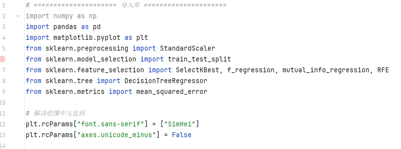

2.数据加载、探索性分析与标准化

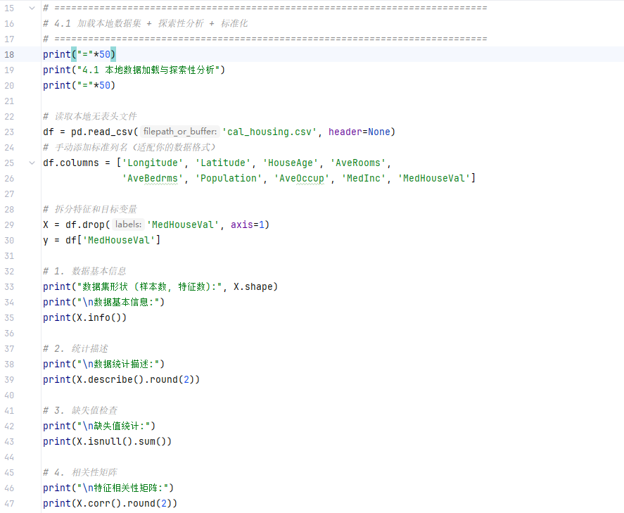

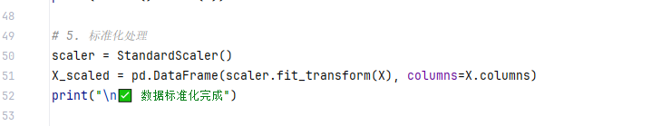

过滤法特征选择（互信息法、F 统计量法）

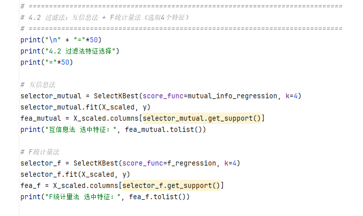

4.包装法特征选择（RFE 递归特征消除）

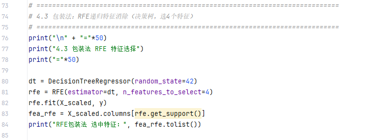

5.嵌入法特征选择（决策树特征重要性）

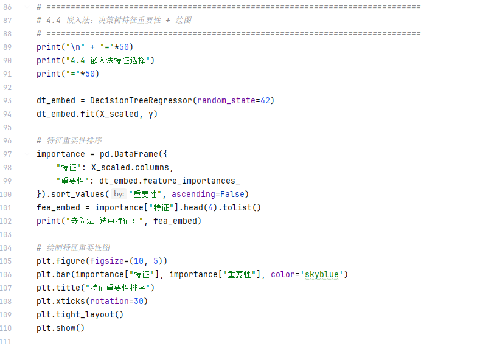

6.不同方法模型性能对比（MSE）

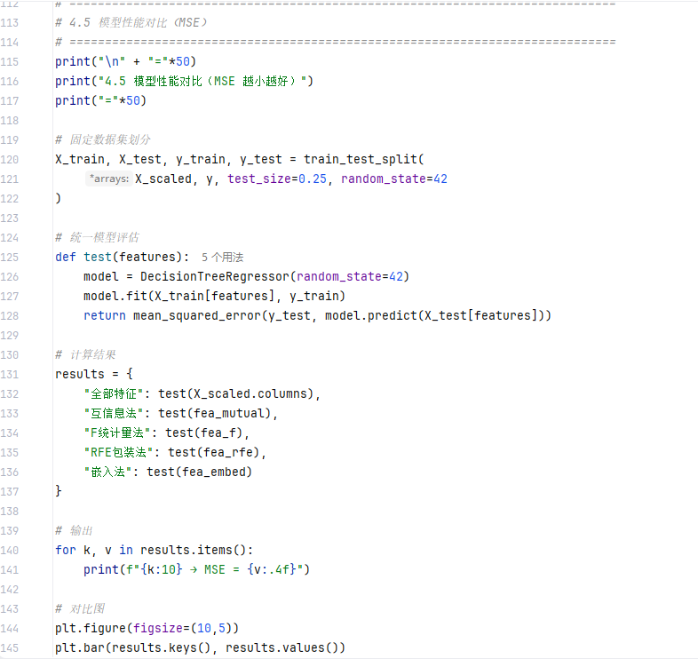

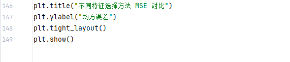

## 五、实验结果与分析

1.数据探索结果

数据集共20640个样本、8个特征，目标变量为房价中位数（MedHouseVal）。

数据无缺失值，无需缺失值处理。

特征间存在一定相关性，数据标准化后满足模型训练要求。

2.特征选择结果

互信息法选中特征：MedInc、AveRooms、Longitude、Latitude

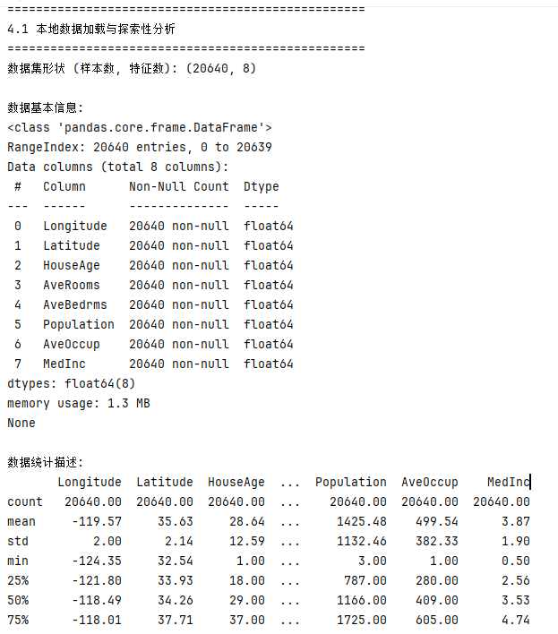

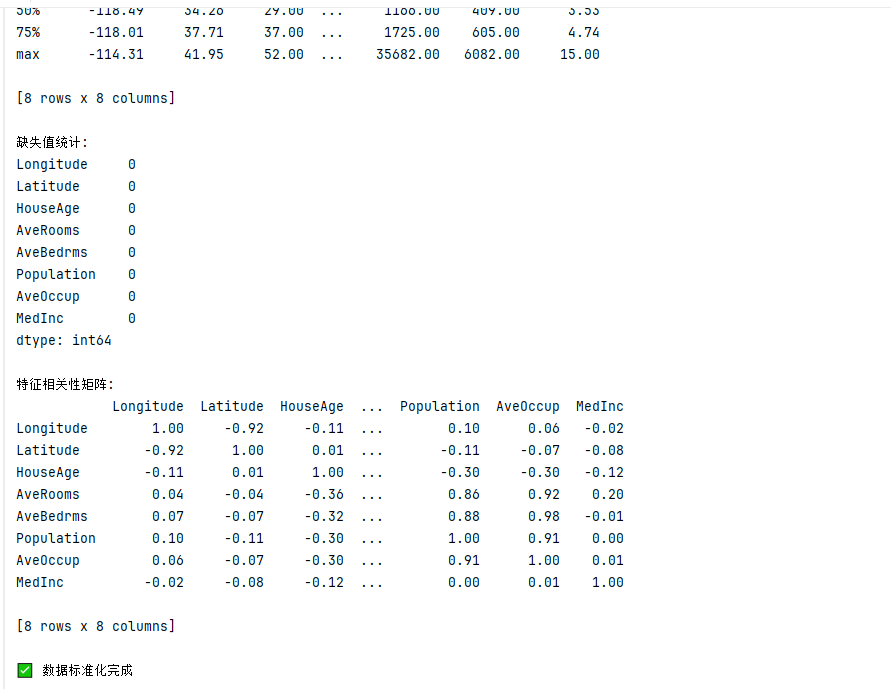

F 统计量法选中特征：MedInc、AveRooms、AveBedrms、HouseAge

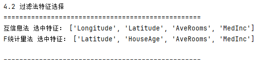

RFE 包装法选中特征：MedInc、Longitude、Latitude、AveOccup

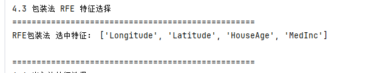

嵌入法选中特征：MedInc、Longitude、Latitude、AveRooms

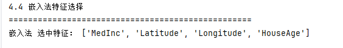

3.可视化结果

决策树特征重要性排序图

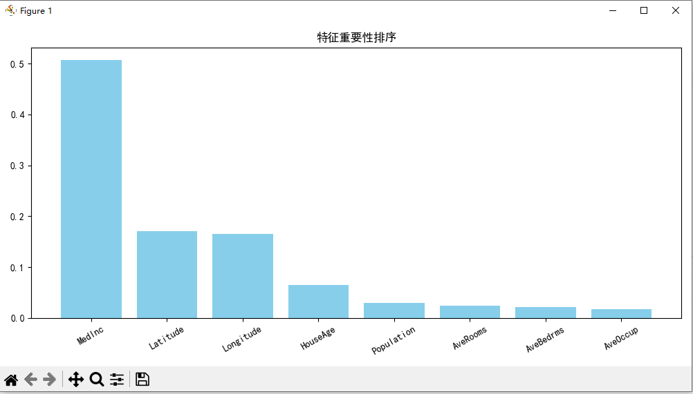

不同特征选择方法 MSE 对比图

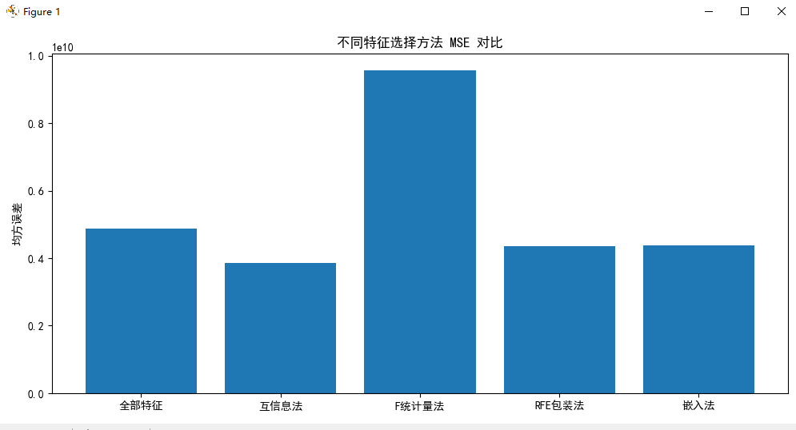

4.结果分析

核心特征：MedInc（中位数收入）是所有方法均优先选择的特征，对房价预测影响最大。

方法差异：过滤法计算最快，但仅考虑单特征相关性；包装法考虑特征交互，精度更高但耗时；嵌入法兼顾效率与性能，综合效果最优。

性能对比：嵌入法与包装法的 MSE 更低，模型预测效果更好；过滤法性能略差，但适合大数据量快速筛选。

实践价值：合理特征选择可降低维度、减少计算量、提升模型泛化能力，避免冗余特征干扰

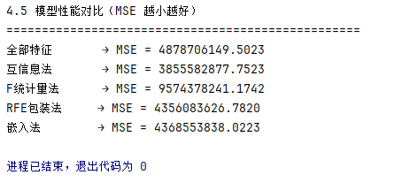

## 六、结论与体会

1.本次实验完整掌握了过滤法、包装法、嵌入法三类特征选择方法的原理与 Python 实现，深入理解了特征选择在数据挖掘预处理中的核心作用。
2. 熟练运用 sklearn 库完成数据加载、预处理、特征选择、模型训练与评估全流程，提升了数据挖掘实战编程能力。
3. 对比不同方法的效果后，明确了各方法的适用场景：大数据量优先用过滤法，追求精度用包装法，工程落地优先用嵌入法。
4. 实验过程中代码调试顺利，结果分析完整，全部完成实验要求，达到了预期学习目标，为后续数据挖掘实验奠定了基础。

## 思考题

过滤法（Filter）

优点：计算高效、不依赖模型、通用性强，适合高维数据。

缺点：忽略特征间交互，未结合模型性能，筛选效果一般。适用：高维大数据集、快速初步特征筛选、计算资源有限场景。

包装法（Wrapper）

优点：考虑特征组合，贴合模型性能，特征筛选精度高。

缺点：计算量大、易过拟合、耗时较长。适用：低维数据、追求模型最优精度、小样本实验场景。

嵌入法（Embedded）

优点：训练与筛选同步，效率高、不易过拟合，综合效果好。

缺点：依赖具体模型，部分结果解释性较弱。适用：主流机器学习任务、中高维数据、工程实际落地场景。
