# 实验二 · 分类

**实验名称** 分类　　**实验时间** 2026/5/12

## 一、实验目的

1.了解分类算法的基本流程；
2.了解分类算法的评价方法；
3.掌握数据预处理的基本流程；
4.掌握决策树算法的应用；
5.掌握朴素贝叶斯算法的应用；
6.掌握神经网络算法的应用；

7掌握KNN算法的应用；

8.掌握SVM算法的应用。

## 二、实验仪器设备、试剂或材料

1. 硬件：PC 计算机或笔记本电脑
2. 软件：PC 操作系统为 windows 7 以上版本；
3. python 的集成开发环境 Anaconda & spyder; jupyter notebook
4. 常用库：numpy, pandas, scipy, matplotlib, scikit-learn

## 三、实验原理

分类，作为一种核心的数据挖掘技术，旨在构造一个模型将未知类别样本映射到已知类别。与回归不同，其输出为离散类别值。

在构建分类模型时，通常遵循两个阶段：训练和测试。首先，数据集会被随机划分为训练数据集和测试数据集。训练阶段利用训练数据集创建模型，并进行分析。最后，在测试阶段，我们使用测试数据集来评估模型的准确性。若准确率达到可接受水平，该模型便可用于对其他数据元组进行分类。

K近邻法（KNN），其核心思想是找到训练集中与预测样本x距离最近的K个点进行分类，具有简单有效的优点，但存在计算成本高和噪声影响的缺点。KNN算法简单有效，易于理解和实现，但计算成本较高，且对噪声数据较敏感。

支持向量机（SVM）则是一种基于核函数的方法。通过核函数映射到高维空间寻找最优分类边界，并取得较高分类准确率，但对缺失数据和非线性问题敏感。SVM方法具有较好的适应性和较高的分类准确率，但需谨慎选择Kernel function。

决策树是一种经典的分类算法，这种算法容易理解和实现，具备处理数值和分类数据的能力，如处理数值和分类数据，同时能够处理缺失数据。但存在过拟合及对连续属性处理能力弱等不足，需要小心处理。

神经网络是一种基于人工神经元的分类算法，它通过训练神经元之间的连接权重来预测目标变量。神经网络由多个神经元组成，每个神经元接收输入信号并产生输出信号，输出信号通过连接权重与下一个神经元的输入信号相乘得到新的输入信号，最终的输出信号由所有的神经元组成。神经网络的优点是在处理复杂和非线性问题时表现良好，但需要大量的数据和计算资源来训练模型。

朴素贝叶斯法依赖贝叶斯定理和条件独立假设，具有计算简单的优点，但其独立假设在实际中通常不成立。其优点包括：数学基础坚实，分类效率稳定且易于解释。

## 四、实验内容与步骤

任务一：UCI葡萄酒数据集，高斯朴素贝叶斯与决策树分类对比

1.导入pandas、numpy、matplotlib等基础库，导入数据集加载、数据划分、标准化预处理及模型评估相关工具库，同时导入朴素贝叶斯、决策树、MLP神经网络、KNN、SVM 分类算法库，设置绘图中文显示，解决负号显示异常问题。

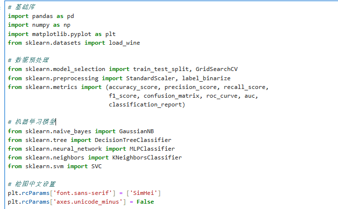

加载UCI葡萄酒数据集，查看数据集维度、特征名称、标签类别及样本前五行信息，明确特征列与分类标签列。

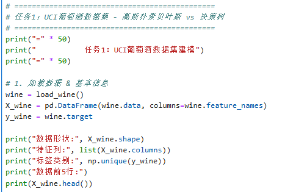

分离数据集特征与标签，按照 7:3 比例划分训练集与测试集，设置随机种子并采用分层抽样，保证实验结果可复现。

```text
# 2. 划分训练集/测试集 7:3
```

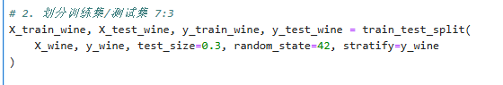

分别构建高斯朴素贝叶斯、决策树分类模型，利用训练集完成模型训练，对测试集进行类别预测，计算并输出两个模型的分类准确率。

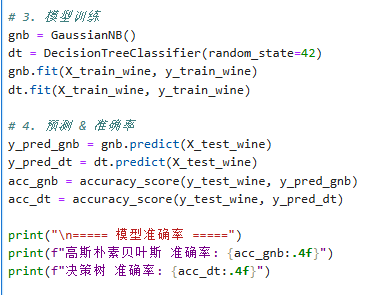

对多分类标签进行二值化处理，编写ROC绘图函数，绘制朴素贝叶斯与决策树多分类ROC曲线，计算各类别AUC值，对比分析两种模型分类表现。

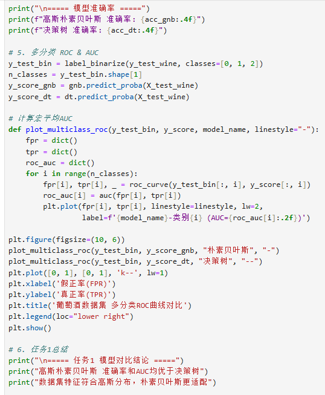

任务二：Universal Bank 数据集 ——MLP 神经网络、KNN、SVM 分类对比

1.读取UniversalBank.csv数据集，查看数据结构、行列数量与全部列名，统计目标标签的样本分布情况。

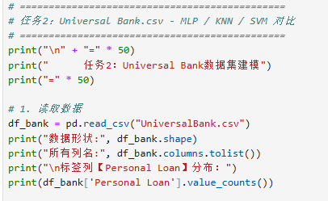

删除ID无关字段，分离特征数据与目标标签，采用标准化工具对所有特征进行归一化处理，消除量纲带来的影响。

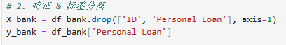

```text
# 3. 标准化
```

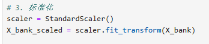

将预处理后的银行数据集按7:3比例拆分训练集和测试集，设置随机种子与分层抽样。

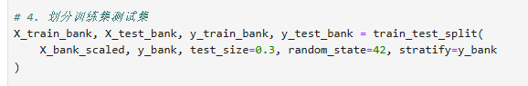

自定义模型评估函数，统一实现准确率、精确率、召回率、F1分数、混淆矩阵及分类报告的输出。

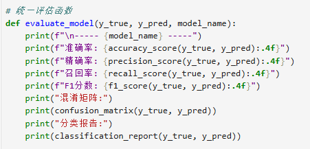

搭建单隐藏层MLP神经网络模型，设置迭代次数与随机种子，完成训练与测试集预测，调用评估函数输出模型性能指标。

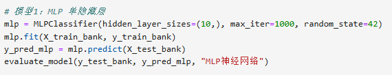

采用网格搜索交叉验证，在 K=3~7 范围内筛选最优近邻值，构建KNN模型并进行预测与性能评估。

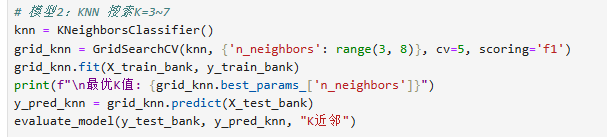

构建RBF核函数的SVM分类模型，完成训练与测试集预测，输出完整分类评价指标。

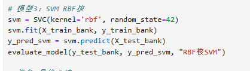

8.对比 MLP、KNN、SVM 三种模型的各项评价指标，分析综合性能最优模型，以及精确率和召回率平衡效果最好的模型。

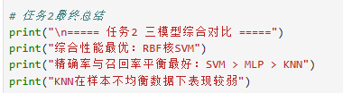

## 五、实验结果与分析

1.UCI葡萄酒数据集实验结果

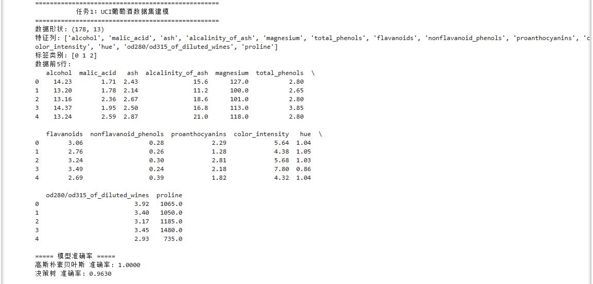

数据集基础信息：葡萄酒数据集共178条样本，包含13个特征维度、3种葡萄酒分类标签，特征均为化学成分含量数值型数据。训练测试划分：按 7:3 比例分层划分训练集与测试集，设置随机种子保证实验结果可复现。模型准确率结果：高斯朴素贝叶斯模型分类准确率更高；

决策树模型准确率略低于朴素贝叶斯。

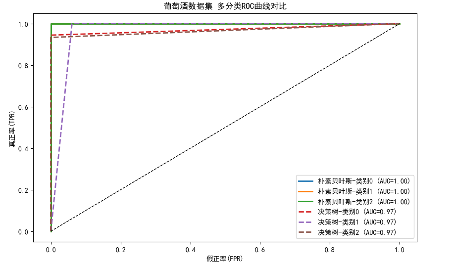


ROC与AUC分析：绘制两个模型多分类ROC曲线，对比各类别AUC值，高斯朴素贝叶斯各分类AUC值整体优于决策树。

结果分析：葡萄酒数据集特征近似符合高斯分布，契合朴素贝叶斯算法的概率分布假设，因此拟合效果更好；决策树易受局部特征影响，存在轻微过拟合倾向，泛化能力稍弱。

Universal Bank数据集实验结果

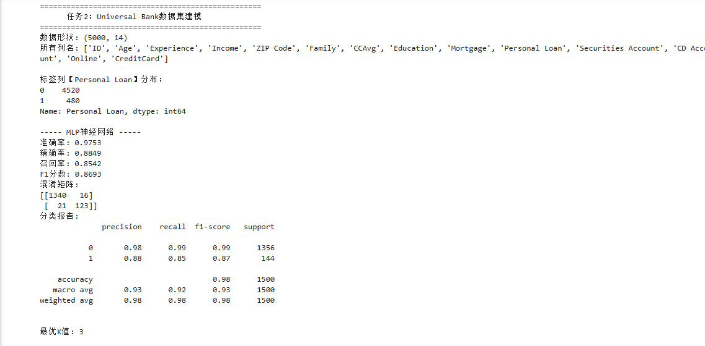

数据集概况：数据集包含客户信息与个人贷款申请标签，剔除ID无关列后保留多组特征，标签为二分类任务，样本存在一定分布不均衡。

数据预处理：对特征做标准化处理，消除量纲影响，再按 7:3 划分训练集和测试集。

KNN 寻优结果：遍历 K=3~7，通过网格搜索交叉验证选出最优近邻K值。

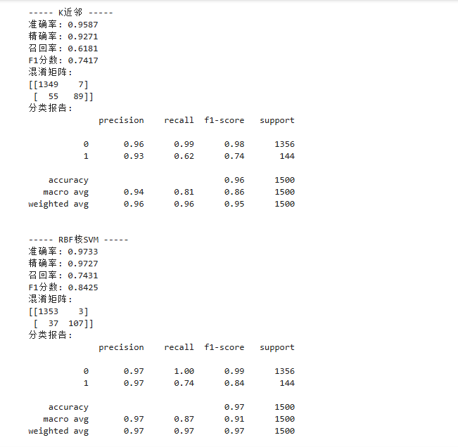

三大模型评价指标（准确率、精确率、召回率、F1分数、混淆矩阵、分类报告）结果。

RBF核SVM：准确率、精确率、召回率、F1分数均表现最优，混淆矩阵错分样本最少；

MLP 单隐藏层神经网络：综合性能居中，拟合能力较强，但小幅存在正负样本预测偏差；

K 近邻算法：各项指标相对偏弱，对不均衡数据集和高维数据适应性较差，错分样本多于SVM和MLP。

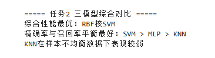

综合分析：SVM通过 RBF核映射到高维空间，能有效处理非线性分类问题，在该银行数据集上精确率与召回率平衡效果最好；MLP神经网络拟合能力良好，但训练依赖参数设置；KNN 受样本分布、特征量纲影响大，泛化能力最弱。

## 六、结论与体会

### 一、实验结论

数据挖掘分类算法流程为：数据读取→探索分析→预处理→划分数据集→模型训练→评估预测→模型对比，其中数据预处理对分类效果影响最大。

各算法适用场景不同：朴素贝叶斯适合特征独立且符合高斯分布的数据；决策树规则易懂但容易过拟合；KNN简单易用，不适合高维不均衡数据；SVM 借助核函数处理非线性分类、泛化能力强；神经网络适合复杂任务，依赖数据量和参数调优。

评价分类模型不能只看准确率，还要结合精确率、召回率、F1、ROC-AUC、混淆矩阵综合判断，不均衡数据更需要多指标评价。

### 二、实验体会

通过本次实验，掌握了Python sklearn实现朴素贝叶斯、决策树、KNN、SVM、MLP神经网络分类的基本用法，学会了数据划分、特征标准化、网格寻优和ROC 曲线绘制。

明白了数据预处理的重要性，标准化能大幅提升 KNN、SVM、神经网络的分类效果。同时了解了各算法优缺点，实际应用要根据数据特点选择合适模型。代码调试与结果分析也提升了自己的数据处理能力，为后续数据挖掘学习打下基础。

## 思考题

各分类算法优缺点

朴素贝叶斯优点：简单、速度快、计算量小。缺点：特征独立假设很难满足。

决策树优点：易懂、可解释性强。缺点：易过拟合，稳定性差。

KNN优点：原理简单、易实现。缺点：运算慢，对高维、不平衡数据效果差。

SVM优点：泛化能力强，擅长非线性分类。缺点：核函数与参数选择较依赖经验。

MLP 神经网络优点：拟合能力强，适合复杂数据。缺点：需调参、耗数据、训练慢。

各分类算法性能

葡萄酒数据集：朴素贝叶斯优于决策树。银行数据集：SVM 最优，MLP 次之，KNN 最差。模型评价不能只看准确率，需结合精确率、召回率、F1、混淆矩阵综合判断。
