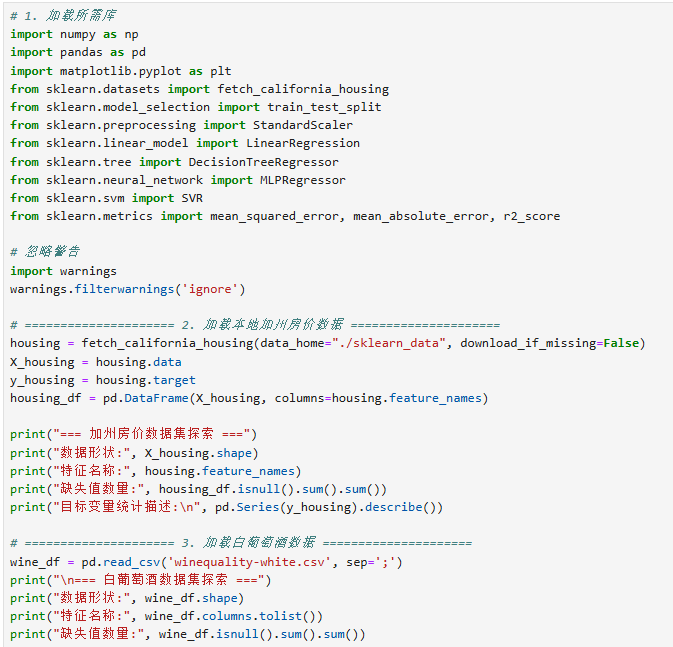
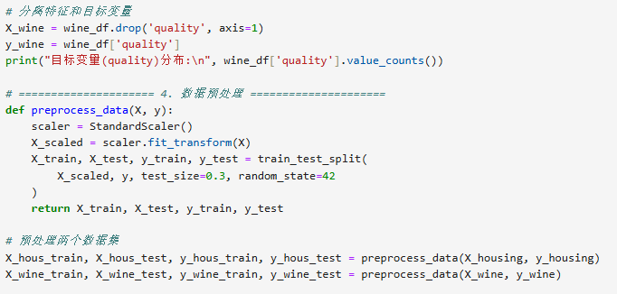
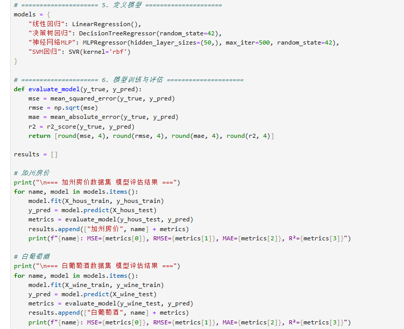
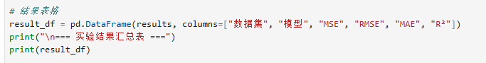
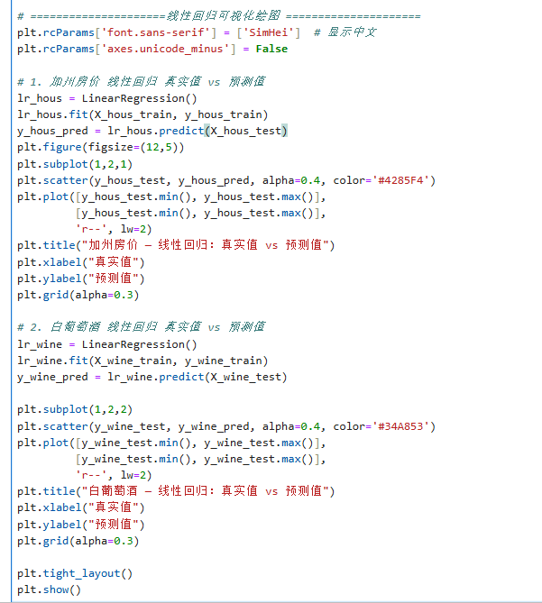
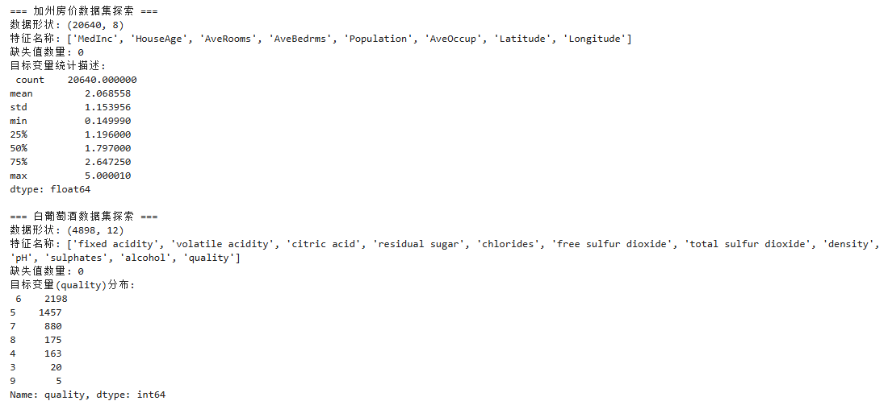
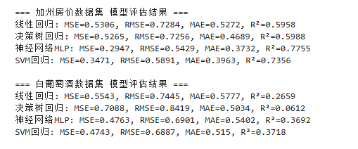
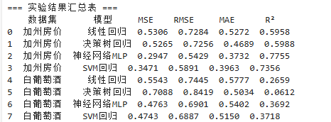
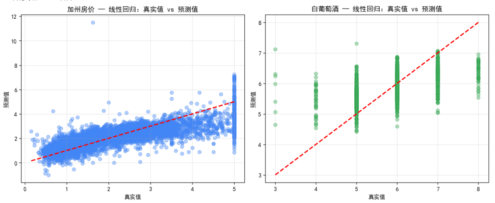

# 实验三 · 回归

**实验名称** 回归　　**实验时间** 2026/5/14

## 一、实验目的

1、了解回归的概念；
2、了解常用的回归模型；
3、理解回归模型的评价指标；
4、掌握线性回归的应用；
5、掌握其它常用回归的应用。

## 二、实验仪器设备、试剂或材料

1. 硬件：PC 计算机或笔记本电脑
2. 软件：PC 操作系统为 windows 7 以上版本；
3. python 的集成开发环境 Anaconda & spyder; jupyter notebook
4. 常用库：numpy, pandas, scipy, matplotlib, scikit-learn

## 三、实验原理

统计学上，回归是指研究两组数据数值上的关系，并用来预测因变量的发展趋势的一种统计分析方法。回归分析按照涉及变量的多少，分为简单线性回归和多元线性回归；按照自变量和因变量之间的关系类型，可分为线性回归分析和非线性回归分析。常用的回归算法包括线性回归、多项式回归、SVM、岭回归、Lasso、神经网络、CART决策树回归等。在大数据分析中，回归主要有以下方面的应用：

（1）用于预测以及发现变量之间的因果关系。例如，学生的成绩与他在学习方面花费的时间之间的关系。

（2）可以用来制定计划和实施计划控制。例如计划制定、KPI制定等方面；

（3）可以基于预测的数据与实际数据进行比对和分析，确定事件发展程度并及时给未来行动提供方向性指导

## 四、实验内容与步骤

1.首先加载所需的库，并从sklearn.datasets中调用fetch_california_housing()加载加州房价数据，同时从本地读取winequality-white.csv白葡萄酒数据文件。对两个数据集分别进行探索性查看，了解特征名称、数据形状、是否有缺失值以及目标变量的分布情况。加州房价数据通常已经清洗完毕可直接使用，白葡萄酒数据需检查是否存在缺失值如有则进行填充或删除处理。

将每个数据集的特征和目标变量进行分离。并对所有特征进行标准化处理（减去均值除以标准差），这样每个模型都在相同尺度的数据上进行训练。按7：3的比例将每个数据集划分为训练集和测试集并设置随机种子以保证结果可复现。

分别使用LinearRegression、DecisionTreeRegressor、MLPRegressor（设置一个隐藏层，神经元数量可设为50或100，最大迭代次数设为500）和SVR（核函数选择RBF）在训练集上建模，然后在测试集上进行预测。对于每个模型在每个数据集上的预测结果，需要计算回归评价指标，至少包括均方误差（MSE）、均方根误差（RMSE）、平均绝对误差（MAE）和决定系数（R²）。将两个数据集上四个模型的评价结果整理成表格形式以便对比。

4.最后进行综合分析：分析同一模型在两个数据集上的表现差异，模型是否在不同类型的数据上表现稳定；结合模型特点解释结果差异，例如决策树容易过拟合、SVR对参数敏感、神经网络需要较多数据等。

数据可视化

## 五、实验结果与分析

1. 数据探索结果

模型评价指标汇总表

数据集差异分析

同一模型在不同数据集上的表现

线性回归预测结果可视化分析

为直观对比线性回归在两个数据集上的拟合效果，绘制了真实值与预测值散点对比图，图中红色虚线为理想预测线（真实值=预测值），点越靠近红线说明预测效果越好。

（1）加州房价数据集线性回归可视化分析

在加州房价数据集的散点图中，蓝色数据点整体沿红色虚线分布，呈现出明显的线性正相关趋势，说明线性回归模型捕捉到了房价与特征间的线性关系，预测结果与真实值偏差较小。但仍存在部分偏离较远的点，且在房价高值区域（>4）出现了预测值被截断的情况，这与数据集本身的房价上限（5.00001）及模型对极端值的拟合能力有限有关，也解释了模型 R² 仅为0.5958的原因。

（2）白葡萄酒数据集线性回归可视化分析

在白葡萄酒数据集的散点图中，绿色数据点呈现出“竖条状”分布，同一真实质量等级对应了大量不同的预测值，点与红色虚线的偏离程度远大于加州房价数据，说明线性回归模型无法有效拟合葡萄酒质量与理化特征间的非线性、弱相关关系。模型对3-4分的低质量葡萄酒预测普遍偏高，对7-8分的高质量葡萄酒预测普遍偏低，整体预测误差较大，与R²仅为0.2659的评价结果完全吻合。

（3）两张图对比结论

加州房价数据点更贴近理想预测线，说明线性回归在存在较强线性关系的连续数据上表现更稳定；

白葡萄酒数据点高度分散，说明线性回归无法处理弱相关、离散型目标变量，拟合效果极差，也印证了后续非线性模型（MLP、SVM）在该数据集上的优势。

## 六、结论与体会

1. 实验结论

回归模型适用场景明确：线性回归适用于线性关系数据；神经网络和SVM回归对线性、非线性数据均有良好拟合能力；决策树回归容易过拟合，不适合噪声大、特征相关性弱的数据。

数据质量决定模型上限：加州房价数据质量高、相关性强，模型效果显著优于白葡萄酒数据。

标准化非常重要：SVM、神经网络对数据尺度敏感，标准化可大幅提升模型精度与训练速度。

评价指标意义清晰：MSE、RMSE、MAE越小表示误差越小；R²越接近1表示模型解释力越强。

可视化分析是模型评估的重要补充：真实值与预测值散点图能直观反映模型拟合效果，弥补了单一数值指标的不足，帮助我们更全面地理解模型的优缺点。

2. 实验体会

通过本次实验，我系统掌握了回归分析的基本概念、常用模型及评价方法。完成了从数据加载→探索分析→数据预处理→模型构建→预测评估→可视化对比→结果分析的完整机器学习流程。

我深刻理解到不同算法有不同的适用场景，不能盲目使用，必须结合数据特点进行选择。同时，数据清洗、标准化、数据集划分等预处理步骤对模型效果起到决定性作用。此外，可视化分析让我对模型的拟合效果有了更直观的认识，也让我意识到“数据+模型 +可视化”的综合分析方法在大数据分析中的重要性。

本次实验提升了我的数据分析与机器学习实践能力，让我对回归预测有了更直观、更深入的理解，为后续学习更复杂的算法打下了坚实基础。

思考题：分类与回归的联系与区别是什么？

联系：

都属于监督学习，都需要带标签的训练数据；

都是通过模型学习自变量与因变量的映射关系，用于预测任务。

区别：

预测目标不同：回归预测连续数值（如房价、葡萄酒评分）；分类预测离散类别（如合格/不合格、好坏）。

输出形式不同：回归输出连续实数；分类输出有限离散标签。

评价指标不同：回归用 MSE、RMSE、R²等；分类用准确率、精确率、召回率等。
