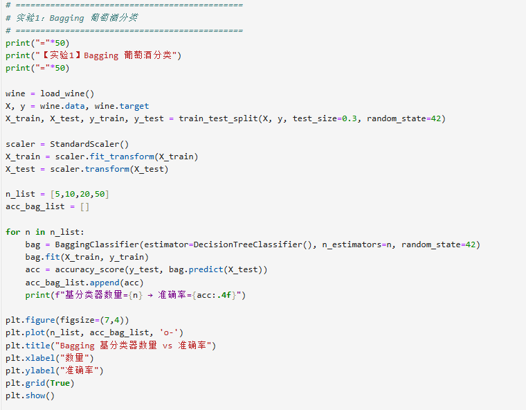
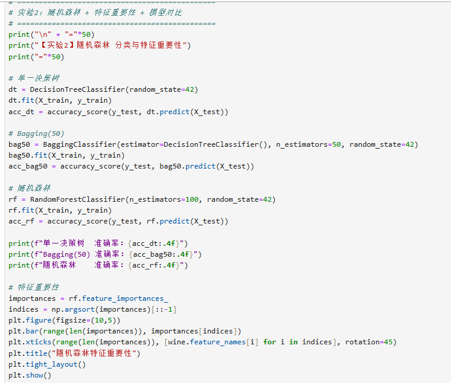
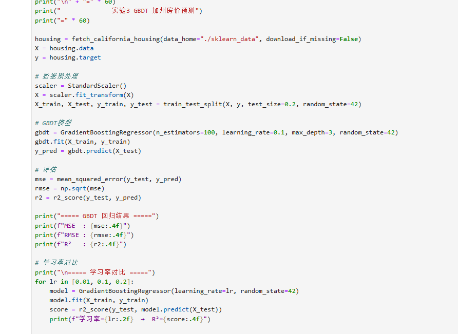
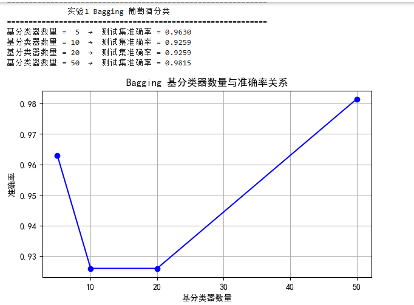
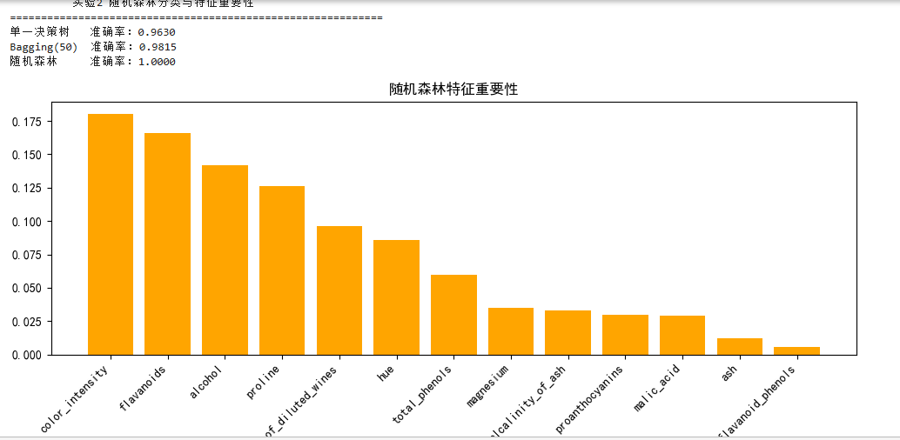
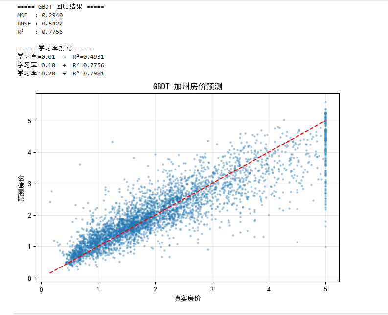

# 实验四 · 集成技术

**实验名称** 集成技术　　**实验时间** 2026/6/2

## 一、实验目的

1、了解集成技术的基本概念；
2、掌握基本集成技术的应用；
3、掌握随机森林算法的应用；
4、掌握提升树算法的应用。

## 二、实验仪器设备、试剂或材料

1.硬件：PC计算机或笔记本电脑
2.软件：PC操作系统为windows7以上版本；
3.python的集成开发环境Anaconda&spyder;jupyternotebook
4.常用库：numpy,pandas,scipy,matplotlib,scikit-learn

## 三、实验原理

集成技术是数据挖掘中的一个重要研究领域。它的特点是，不采用单一的模型进行分类，而是通过构造多个独立模型的组合，来建立一个性能更优的分类器或回归器。基本的集成技术主要包含三种：装袋（Bagging）、提升（Boosting）和堆叠（Stacking）。

1.装袋(Bagging)

装袋方法先从训练集D中对数据进行有放回的抽样，获得一个规模与原数据集一样的训练集D_k,这样的抽样总共进行K次；然后在每一个训练集D_k上训练一个分类模型M_k;对于新来的数据对象进行决策时，将所有分类器的识别结果按投票（或加权投票）的方法进行组合，得票最多的类标签就作为新数据所属的类别。

2.提升(Boosting)

在提升算法中，训练集中的每条数据被赋予了权重，表示它们被重视的程度。权重越高，它们被错分的代价越高，迫使分类器将它们正确的分类。与装袋算法不同，提升算法迭代地训练K个基本分类器，在带权重的数据集上训练一个基分类器M_i后，对其性能进行评价，并增大被它错分的训练样本的权重，然后训练下一轮的基分类器M_i+1，最后根据所有基分类器的性能对它们进行加权组合，实现最终集体决策。

3.堆叠(Stacking)

堆叠(Stacking),也称作元集成（metaensembling）。与装袋、提升算法不同，堆叠是一种将多种不同类型的分类器组合在一起的集成技术。

它是一种两层的集成模型，首先在训练数据集上采用不同的算法独立地训练几个基分类器（模型）作为第一层；再组合第一层模型的输出生成新的数据集（原始的数据集中的标签仍作为新数据集的标签），并在新数据集上训练第二层的分类器（也称为“元模型”）。

4.随机森林（Random Forest）

随机森林是以CART决策树作为基模型的集成技术，它基本上是一种装袋模型，它在构建决策树时使用了随机的特征选择方法。随机森林为了获得有差异的决策树，采用了随机的方法选择数据集和特征集，这也是它的名称“随机”的由来。在预测阶段，随机森林的每棵决策树对待预测的数据记录x′进行分类，采用投票方式选择最终预测结果。

5.提升树（BoostedTree）

提升树是一种回归的集成模型，它的基模型是CART回归树。与随机森林基于装袋思想构造集成模型的方式不同，提升树采用提升的思想集成多棵树。

## 四、实验内容与步骤

1.基于Bagging算法的葡萄酒分类实验

数据准备：使用Scikit-learn库加载UCI葡萄酒数据集（Winedataset）。对13个特征进行标准化处理（如使用StandardScaler），并将数据集按合理比例（如7:3或8:2）划分为训练集和测试集。

模型构建与训练：构建BaggingClassifier分类器，指定基分类器为未剪枝的决策树（DecisionTreeClassifier）。

调参与性能分析：

设定不同的基分类器数量（如5、10、20、50），分别在训练集上进行训练，并在测试集上输出分类准确率（Accuracy）。

思考与观察：观察随着基分类器数量的增加，测试集准确率的变化趋势，理解Bagging方法如何通过集成多个弱分类器来降低模型方差并提升泛化性能。

2.基于随机森林（RandomForest）的葡萄酒分类及特征重要性分析

模型构建与训练：使用RandomForestClassifier构建随机森林分类器。设定森林中决策树的数量（如100棵），利用相同的训练集进行模型训练。

对比分析：

在测试集上评估随机森林的分类准确率。

将随机森林的预测结果与单一决策树以及步骤1中的Bagging分类器进行横向对比，分析随机森林引入“特征随机选择”后对模型性能带来的影响。

3.基于梯度提升树（GBDT）的加州房价预测回归实验

数据预处理：加载加州房价数据集（CaliforniaHousingdataset）。该数据集包含约20,640个样本、8个特征变量及1个连续型目标变量（房价中位数）。对特征进行标准化处理，并划分训练集与测试集。

模型构建与训练：鉴于该任务为回归问题，构建梯度提升回归树模型（GradientBoostingRegressor）。初始参数可设定为：树的数量（n_estimators=100）、学习率（learning_rate=0.1）以及最大深度（max_depth=3）。

模型评估：在测试集上进行预测，计算并输出均方误差（MSE）和决定系数（$R^2$），评估模型的回归拟合效果。

调参拓展（可选）：尝试调整学习率（如0.01、0.1、0.2）或树的深度，观察模型是否存在欠拟合或过拟合现象，体会Boosting算法“步步为营、减少偏差”的核心思想。

## 五、实验结果与分析

1.

2.

3.

## 六、结论与体会

通过本次集成学习实验，我完成了 Bagging、随机森林和 GBDT 三种模型的实践，对集成技术有了更清晰的理解。结论如下：Bagging 通过并行集成降低模型方差，随基分类器数量增加，准确率逐渐趋于稳定；随机森林在 Bagging 基础上加入特征随机选择，进一步提升了泛化能力，效果优于单一决策树与普通 Bagging；GBDT 以串行方式不断减小残差，在加州房价回归任务中表现良好，学习率直接影响收敛速度与拟合效果，过小易欠拟合，过大虽效果更优但存在过拟合风险。

体会：集成学习通过组合多个弱模型，能显著提升预测稳定性与精度。数据预处理、标准化和超参数调优对模型效果至关重要。本次实验让我掌握了集成算法的核心思想，提高了机器学习编程与数据分析能力，也加深了理论与实践结合的理解。

## 思考题

区别:

常用分类算法（如决策树、KNN、逻辑回归）是单一模型，只训练一个模型做预测，容易出现过拟合或欠拟合，泛化能力有限。

集成技术（Bagging、随机森林、GBDT）是组合多个单一模型共同决策，通过降低偏差或方差提升效果，预测更稳定、准确率更高。

联系:

集成技术以常用分类算法作为基模型（最常用决策树）。

两者目标一致，都是对数据进行分类 / 回归预测。

集成模型本质是多个单一模型的优化组合。
