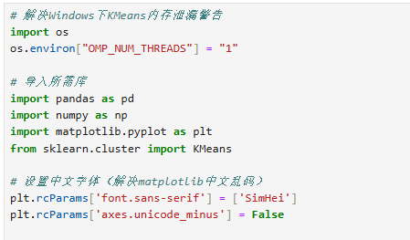
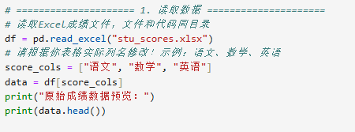
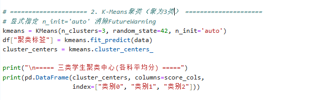
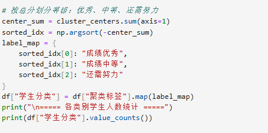
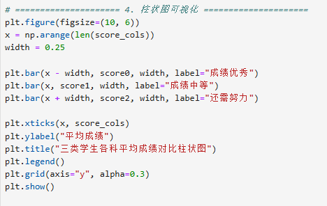
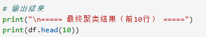
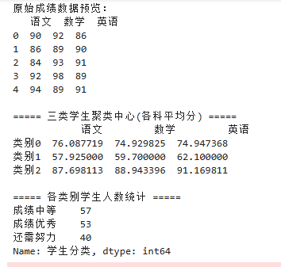
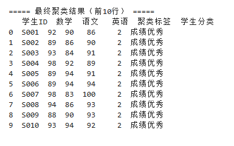
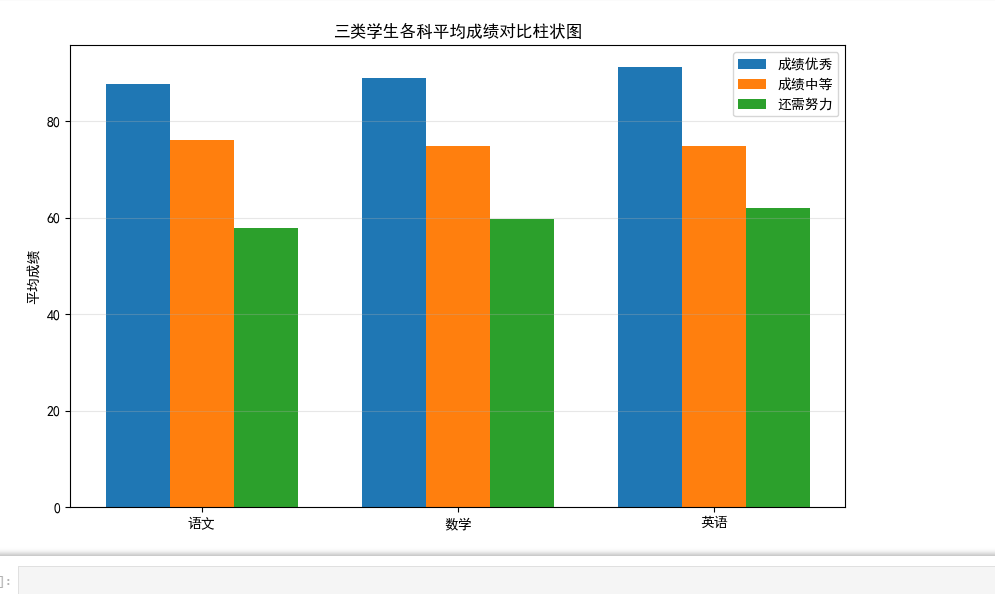

# 实验五 · 聚类分析

**实验名称** 聚类分析　　**实验时间** 2026/6/11

## 一、实验目的

1.了解聚类算法的基本流程；
2.了解聚类算法的评价方法；
3.掌握聚类的基本流程；
4.掌握KMeans算法的应用；

## 二、实验仪器设备、试剂或材料

1. 硬件：PC 计算机或笔记本电脑
2. 软件：PC 操作系统为 windows 7 以上版本；
3. python 的集成开发环境 Anaconda & spyder; jupyter notebook
4. 常用库：numpy, pandas, scipy, matplotlib, scikit-learn

## 三、实验原理

将一群物理的或抽象的对象，根据它们之间的相似程度分成不同的类(簇)，使得各簇之间的相似度尽可能小，而簇内数据之间则具有较高的相似度，这一过程就称为聚类。

一个类(簇)就是由彼此相似的一组对象所构成的集合，每个簇可能对应于一些潜在的我们已知的概念(类别)，但这类概念对于聚类算法而言事先是未知的，聚类过程仅能自动形成簇结构，簇所对应的概念语义需由使用者来把握和命名。

采用聚类分析技术，可以把无标识数据对象自动划分为不同的类，并且可以不受先验知识的约束和干扰，获取属于数据集合中原本存在的信息。

聚类的常用算法如：K-means。

K-means聚类算法是一种无监督分类算法，通过分离k个相等方差组的样本来聚集数据，最小化簇内误差平方和SSE (Sum of the Squared Error, SSE)。

简单来说，就是根据指定的簇的数量，分离出n组数据，并令它们每组的标准(簇内误差平方和)最小化。

## 四、实验内容与步骤

1.环境准备：确认已安装所需 Python 第三方库，将数据文件 stu_scores.xlsx 与代码放在同一目录。

数据读取：使用 pandas 读取 Excel 成绩数据，提取三门课程成绩作为聚类特征。

模型构建：初始化 K-Means 模型，设置聚类数 \(k=3\)，训练模型并为每个学生分配聚类标签。

结果分类：根据三类聚类中心的总分高低，将聚类标签映射为 “成绩优秀、成绩中等、还需努力”。

5.结果统计：统计每个类别的学生人数，输出各类别平均成绩（聚类中心）。

可视化分析：绘制柱状图，直观展示三类学生的成绩分布与特征。

6.问题分析：结合实验现象，分析初始聚类中心对 K-Means 算法的影响。

## 五、实验结果与分析

（1）原始数据概况

原始数据抽取前 5 名学生成绩可见，样本单科分数区间集中在 84~98 分，属于高分段样本，整体基础不差；完整数据集一共包含 57+53+40 = 150 名学生成绩记录。

（2）聚类中心分数拆解

程序自动计算出 3 个簇的各科平均分，并按照三科总分高低完成等级划分：

成绩优秀（原类别 2）

语文：87.70 分、数学：88.94 分、英语：91.17 分

三科总分约 267.81 分，三科均衡且全部处于高分段，英语平均水平略高于语文、数学。

成绩中等（原类别 0）

语文：76.09 分、数学：74.93 分、英语：74.95 分

三科总分约 225.97 分，三科分数十分接近，整体稳定在 75 分上下，属于中游水平。

还需努力（原类别 1）

语文：57.93 分、数学：59.70 分、英语：62.10 分

三科总分约 179.73 分，三科均不及格，英语相对稍好，数学、语文薄弱。

（3）各层次人数分布

成绩中等：57 人，占比最高（38%），是班级主体人群；

成绩优秀：53 人，占比 35.3%，高分群体规模略少于中等；

还需努力：40 人，占比 26.7%，低分学生数量最少。

整体分布符合常规班级成绩金字塔形态，中间大、两头小。

（4）单条样本分类校验

从前 10 条学生分类结果能够验证聚类准确性：S001~S010 所有学生三科分数均在 84 分以上，全部被划分为成绩优秀，和聚类中心高分特征完全匹配，算法分类逻辑无误。

三类学生各科平均分柱状图

纵向对比：每一门科目里，蓝色优秀柱高度＞橙色中等柱＞绿色待努力柱，分层界限清晰，聚类划分梯度明显；

横向对比：优秀组英语平均分是三科里最高的；中等组三科分数几乎持平；待努力组同样英语小幅高于语数；

差距直观：优秀组与中等组单科分差普遍在 11~16 分，中等和待努力组分差 15~17 分，三个梯队区分度很好，聚类效果理想。

## 六、结论与体会

K-Means 无监督聚类在无人工打分标签的前提下，仅依靠三门课程原始分数，成功自动划分出优秀、中等、薄弱三个学习梯队，分组结果贴合现实教学里的成绩分层逻辑；

本次数据集样本三科成绩趋势高度同步，没有极端偏科干扰，因此聚类边界清晰、分组稳定；

从人数结构看，班级过半学生处于中等及以上水平，但仍有四分之一左右学生基础偏弱，需要针对性辅导；优秀学生英语整体优势突出，可发挥帮扶作用。

## 思考题

聚类中心初始值的选择会如何影响聚类结果？

K-Means 算法对初始聚类中心十分敏感：

若初始中心选取不当，算法容易陷入局部最优解，聚类划分不合理，簇内误差偏大，优秀、中等、待提升三类学生区分混乱。

初始中心分布集中，会增加算法迭代次数，收敛速度变慢；中心分布分散则收敛更快。

随机初始化会导致多次运行得到不一样的聚类结果，稳定性差；若初始中心选到极端分数样本，还会产生异常簇，影响分类效果。
